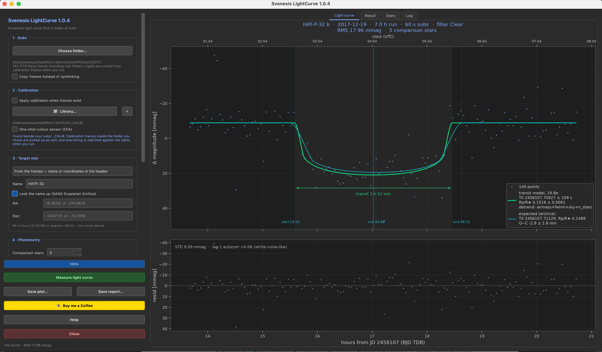

# Svenesis LightCurve — Anleitung

**Version 1.0.21** | Siril Python-Skript für Exoplaneten-Transitphotometrie

> *Ein Ordner Subs hinein, eine Lichtkurve heraus — und eine ehrliche Antwort auf die einzige Frage, die zählt: steckt da ein Transit drin?*

---

## Inhalt

1. [Was ist Svenesis LightCurve?](#1-was-ist-svenesis-lightcurve)
2. [Grundlagen für Einsteiger](#2-grundlagen-für-einsteiger)
3. [Voraussetzungen & Installation](#3-voraussetzungen--installation)
3a. [Kalibrierung](#3a-kalibrierung)
4. [Erste Schritte](#4-erste-schritte)
5. [Die Oberfläche](#5-die-oberfläche)
6. [Den Zielstern wählen](#6-den-zielstern-wählen)
7. [Die Vergleichssterne](#7-die-vergleichssterne)
8. [Die Airmass-Rampe entfernen](#8-die-airmass-rampe-entfernen)
9. [Der Transit-Fit](#9-der-transit-fit)
10. [Ist es echt?](#10-ist-es-echt)
11. [Die Ausgabe lesen](#11-die-ausgabe-lesen)
12. [Gute Daten aufnehmen](#12-gute-daten-aufnehmen)
13. [Fehlersuche](#13-fehlersuche)
14. [FAQ](#14-faq)

---

## 1. Was ist Svenesis LightCurve?

Richte **Svenesis LightCurve** auf den Ordner mit den Subs einer Nacht auf einen Exoplaneten-Wirtsstern. Das Skript misst, wie sich dessen Helligkeit relativ zu anderen Sternen im selben Feld verändert hat, entfernt die systematischen Trends, die es verantworten kann, fittet einen Transit — und sagt dir, ob die Delle echt ist oder ob du eine Wolke ansiehst.

### Wer macht was

Die Arbeitsteilung ist bewusst gewählt und erklärt den größten Teil des Designs.

**Siril macht, was es nachweislich gut kann:** Bereitstellen, Kalibrieren, Zwei-Pass-Registrierung, Sternerkennung, Plate Solve und die Qualität pro Frame.

**Dieses Skript misst den Fluss selbst**, so wie EXOTIC und HOPS es tun — jeder Stern pro Frame neu zentriert, Subpixel-Aperturen, sigma-geclippter Himmel, die Apertur nach Punkt-zu-Punkt-Rauschen gewählt, Vergleichssterne nach ihrer *gemessenen* Streuung behalten (§4a erklärt jedes Teil samt der Messung dahinter). Sirils `light_curve` bleibt als lauter Fallback intakt: misst die Engine unter 30 % der Frames, sagt sie es und übergibt. Und das Skript macht, worüber keine Pixel entscheiden: welcher Stern das Ziel ist, wie man die Airmass-Rampe entfernt, ohne die Transittiefe mitzunehmen, wie man das Ereignis fittet — und vor allem, ob überhaupt etwas behauptet werden darf.

**Gegen EXOTIC an dessen eigenen Beispieldaten validiert** (HAT-P-32 b): Rp/R★ = 0,1554 ± 0,0059 gegen EXOTICs publizierte 0,1541 ± 0,0033 — 0,2 σ auseinander (Stand v1.0.6).

### Der Ablauf

| Schritt | Was passiert | Warum so |
|---|---|---|
| **Bereitstellen** | Subs werden nach `_lightcurve/` verlinkt | Kostet nichts; der Originalordner wird nie beschrieben |
| **Link** | Siril baut eine Sequenz | |
| **Kalibrieren** | Kalibrierframes werden gefunden, zu Mastern gestapelt und über Sirils `calibrate` angewandt | Optional und *delegiert* — in diesem Skript steckt keine Bias-/Dark-/Flat-Arithmetik, aus demselben Grund, aus dem keine Photometrie darin steckt. Reine Pixelrechnung, das Versprechen „kein Resampling" bleibt also unberührt; es wird allerdings eine zweite Kopie jedes Frames geschrieben |
| **Registrieren** | `register -2pass` — nur Daten, **kein Resampling** | Interpolation korreliert Nachbarrauschen und verschiebt Fluss innerhalb der Apertur. Die Apertur folgt dem Stern über die Registrierungsdaten, die Pixel bleiben, wie der Sensor sie aufgezeichnet hat |
| **Erkennen** | Siril findet die Sterne (und löst das Referenzframe astrometrisch, wenn das Ziel Himmelskoordinaten braucht); das Skript wählt Ziel + Vergleiche | |
| **Photometrie** | Die eigene Engine dieses Skripts — Follow-Star, Subpixel-Aperturen, Apertur nach Rauschen gewählt. Sirils `light_curve` als angekündigter Fallback | Am selben driftenden Lauf gemessen: 140 Punkte gegen 67 von `light_curve` |
| **Analyse** | Detrend → Fit → Entscheidung | |

---

## 2. Grundlagen für Einsteiger

**Was ist ein Transit?** Ein Planet, der vor seinem Stern vorbeizieht, blockiert einen Bruchteil des Lichts. Bei einem heißen Jupiter sind das etwa 1–2 % — zehn bis zwanzig **Millimagnituden** — über zwei bis vier Stunden. Eine kleine, langsame Delle. Und alles an ihrer Messung ist ein Kampf gegen Dinge, die ebenfalls kleine, langsame Dellen erzeugen.

**Warum „differentiell"?** Die absolute Helligkeit zu messen ist aussichtslos: Wolken, Transparenzschwankungen und die dünner werdende Atmosphäre beim Aufgang überdecken ein 1-%-Signal um Größenordnungen. Aber sie treffen *alle Sterne im Feld gemeinsam*. Teilt man das Ziel durch mehrere Vergleichssterne, kürzt sich das weg. Übrig bleibt die Eigenvariation des Sterns — der Transit.

**Was ist Airmass?** Wie viel Atmosphäre im Strahlengang liegt. Senkrecht oben 1,0; nahe am Horizont 3 oder mehr, und der Stern wird entsprechend schwächer. Differentielle Photometrie kürzt das größtenteils weg — aber nicht ganz: Ziel und Vergleichssterne haben unterschiedliche Farben und dimmen daher unterschiedlich schnell. Übrig bleibt eine glatte Rampe, und sie zu entfernen, ohne den Transit mitzunehmen, ist ein großer Teil dessen, was dieses Skript tut (§8).

**Was ist eine Magnitude?** Eine logarithmische Helligkeitsskala, bei der *größer schwächer bedeutet*. Eine Millimagnitude (mmag) ist ein Tausendstel. Alle Diagramme hier haben eine invertierte y-Achse, damit oben heller heißt — deshalb liest sich ein Transit als Delle.

### Kleines Wörterbuch

Diese Begriffe tauchen im Rest der Anleitung immer wieder auf. Wer sie kennt, kann den Abschnitt überspringen; alle anderen finden hier die Kurzfassung.

| Begriff | Bedeutung |
|---|---|
| **Sub / Light** | Eine einzelne Aufnahme der Nacht. Hundert Subs à 72 s ergeben zwei Stunden Zeitreihe — hier wird nichts gestackt, jedes Sub wird ein Messpunkt |
| **Apertur** | Der Messkreis um einen Stern. Alles Licht darin wird aufsummiert — das ist die Helligkeitsmessung |
| **Himmelsring (Annulus)** | Ein Ring um die Apertur, der nur Himmel enthält. Sein Mittelwert wird von der Apertur abgezogen, damit Mondlicht und Dämmerung nicht als Sternhelligkeit zählen |
| **FWHM** | „Full Width at Half Maximum" — wie breit ein Stern im Bild ist, in Pixeln. Das praktische Maß für Fokus und Seeing: kleiner ist schärfer |
| **Seeing** | Das Flimmern der Atmosphäre. Es verschmiert Sterne unterschiedlich stark durch die Nacht — und alles, was mit dem Seeing wandert, kann einen Trend in die Kurve schreiben |
| **Zentroid** | Der Lichtschwerpunkt eines Sterns, auf Bruchteile eines Pixels genau. „Neu zentrieren" heißt: die Apertur pro Frame exakt auf diesen Schwerpunkt setzen |
| **Registrierung** | Die Ausrichtung aller Frames aufeinander. Hier wird dabei **kein Bild neu berechnet** — nur gespeichert, wohin jeder Stern gewandert ist |
| **Plate Solve** | Das Bild mit einem Sternkatalog abgleichen, sodass jeder Stern echte Himmelskoordinaten (RA/Dec) bekommt |
| **Ingress / Egress** | Der Eintritt bzw. Austritt des Planeten vor der Sternscheibe — die abfallende und die ansteigende Flanke der Delle. Die vier Eckpunkte heißen **Kontakte**: erster Kontakt = Beginn des Ingress, letzter Kontakt = Ende des Egress |
| **Baseline** | Die Helligkeit des Sterns *außerhalb* des Transits. Jede Aussage über die Tiefe der Delle ist ein Vergleich mit ihr — deshalb ist Messzeit vor und nach dem Transit so wertvoll |
| **Detrend** | Das Entfernen langsamer Trends (Airmass, Seeing, Himmel), die nicht vom Stern kommen, bevor man die Delle beurteilt |
| **MAD** | „Median Absolute Deviation" — ein Streuungsmaß, das ein einzelner Ausreißer (Satellit, Cosmic) nicht aufblähen kann. Wird hier überall statt der gewöhnlichen Standardabweichung benutzt |
| **σ (Signifikanz)** | Wie viele „Rauschbreiten" ein Signal über dem Rauschen liegt. 1σ passiert ständig zufällig; ab 4,5σ nennt dieses Skript eine Delle einen Transit (§10 erklärt, warum genau dieser Wert) |
| **χ²/ν** | Ein Gütemaß des Fits: ≈ 1 heißt, das Modell beschreibt die Daten im Rahmen ihres Rauschens; deutlich größer heißt, es fehlt etwas |
| **Randverdunkelung** | Ein echter Stern ist am Scheibenrand dunkler als in der Mitte. Deshalb ist ein Transitboden *rund*, nicht flach — und ein Modell ohne Randverdunkelung misst die Tiefe systematisch falsch (§9) |
| **Ephemeride** | Der veröffentlichte Fahrplan eines Planeten: Umlaufperiode, Referenz-Transitzeit, erwartete Tiefe und Dauer. Kommt hier von der NASA Exoplanet Archive |
| **T0** | Die gemessene Transitmitte, als Zeitpunkt |
| **O−C** | „Observed minus Calculated": gemessene minus vorhergesagte Transitmitte, in Minuten. Die Zahl, die Ephemeriden aktuell hält — der eigentliche wissenschaftliche Beitrag einer Amateurnacht |
| **BJD_TDB** | Das Zeitsystem der Profis: baryzentrisch (auf den Schwerpunkt des Sonnensystems bezogen, ±8 Minuten je nach Jahreszeit) und in TDB-Zeit. Alle Archiv-Ephemeriden stehen darin |
| **Sättigung / Klipping** | Ein Pixel am Anschlag. Ein „geclippter" Sternkern kann nicht mehr heller werden, skaliert also nicht mehr mit der Transparenz — und verfälscht damit jede Differenzmessung, in der er steckt |
| **Ensemble** | Die Gruppe der Vergleichssterne, gegen die das Ziel gemessen wird. Je stabiler das Ensemble, desto glaubwürdiger die Kurve |

---

## 3. Voraussetzungen & Installation

- **Siril 1.4** oder neuer mit Python-Modul
- Beim ersten Start automatisch installiert: `numpy`, `PyQt6`, `matplotlib`, `astropy`

Lege `Svenesis-LightCurve.py` in einen Ordner namens **Utility** in einem von Sirils Skript-Verzeichnissen (*Einstellungen → Skripte*) und starte es über **Bildverarbeitung → Skripte**.

**Kalibrieren.** Vor allem Flats: ein Stern, der über einen Staubschatten wandert, erzeugt einen langsamen Trend in genau der Form eines flachen Transits. Entweder du zeigst **2 · Calibration** auf deine Master (siehe [3a](#3a-kalibrierung)) oder du kalibrierst vorher wie gewohnt — auslassen ist keine Option.

---

## 3a. Kalibrierung

**Nichts muss vorbereitet werden, und du musst dich nicht durchklicken.** Zeig auf deine Subs — oder auf irgendeinen Ordner darüber — und einmalig auf den Ordner mit deinen wiederverwendbaren Darks. Alles Weitere wird gefunden.

### Wo gesucht wird

Der Scan ist **rekursiv**. Jedes FITS unter dem gewählten Ordner wird einmal gelesen und anhand seines Headers in Lights und Kalibrierframes einsortiert — du kannst also auf die Projektwurzel zeigen:

```
WASP-75b/                       ← hierauf zeigen…
├── LIGHT/2026-08-14/LUMINOS/   ← …die Subs liegen drei Ebenen tiefer
└── FLAT/2026-08-14/LUMINOS/    ← diese auch
_CALIB/DARK/60.00s_G125/        ← dein Library-Ordner, einmal gesetzt
```

Oder direkt auf `LIGHT/2026-08-14/LUMINOS/` — dann werden die Flats trotzdem gefunden, weil das Skript zusätzlich **nach oben** geht und dort jedes Kind eines Vorfahren nimmt, das ein `FLAT`- / `DARK`- / `BIAS`- / `DARKFLAT`-Ordner ist. Nach oben werden nur Kalibrierordner durchsucht, nie ein ganzer Vorfahre: vier Ebenen über einem Sub-Ordner kann ein Verzeichnis mit sämtlichen Projekten der Platte liegen.

### Drei Dinge, die die Rekursion nötig gemacht hat

| Absicherung | Warum |
|---|---|
| **Eigene Ordner ausgespart** | In `_lightcurve/` und `lightcurve/` wird nie hineingegangen — ein zweiter Lauf würde sonst die gestagten Symlinks und konvertierten Frames des ersten wieder als Subs einlesen |
| **Zeitstempel-Konvention geprüft** | DATE-OBS ist per Konvention der Belichtungs*anfang*, die halbe Belichtung wird addiert. Ein `DATE-AVG` (N.I.N.A.) oder `DATE-END` im Header entscheidet das, statt es anzunehmen: eine Software, die die Belichtungsmitte stempelt, wird erkannt, ihre halbe Belichtung nicht addiert, und das Log nennt die Stempel, aus denen die Zeiten stammen. Ein `DATE-AVG` mehr als eine Belichtung plus eine Minute von `DATE-OBS` entfernt ist kein Mittenstempel und wird ignoriert. Die Zeiten des Siril-Rückfalls (DATE-OBS + EXPTIME/2 nach Sirils Konvention) bekommen dieselbe Korrektur, damit beide Engines auf denselben Zeiten landen. Eine falsche Konvention wäre eine halbe Belichtung auf jeder Zeit, 145 s bei 290-s-Subs |
| **Frames nach Zeit sortiert** | Die Sequenz wird in `DATE-OBS`-Reihenfolge gebaut, nicht nach Dateinamen. Ein TOI-4033-Lauf hatte fünf Frames mit den Nummern 43–47, deren Zeitstempel 1–3 h vor Frame 42 lagen; in Dateireihenfolge sahen sie wie ein zweiter Meridian-Flip und ein 60-mmag-Sprung aus. Eine Logzeile nennt, wie viele Frames verschoben wurden |
| **Sternkoordinaten gemessen, nicht angenommen** | Ob Sirils Stern-y eine Dateizeile oder eine gespiegelte ist, hängt davon ab, ob das Plate-Solve das Referenzbild gespiegelt hat. Seit v1.0.12 entscheidet das Skript das nach der Detektion auf den Pixeln des Referenzbilds selbst (welche Lesart die erkannten Sterne auf Sterne setzt) und nutzt das Urteil für jeden Blenden-Seed, die Sättigungsbox und das Feldbild. Auf einem TheSkyX-Satz mit gescheitertem Solve hatte die alte feste Annahme jede Blende auf leeren Himmel gesetzt |
| **Standort und Name aus dem Header, egal in welcher Schreibweise** | SITELAT/SITELONG als `+38 55 48.51` werden als Grad gelesen, damit die höhenbasierte Vorzeichenprüfung einen westpositiven Wert umdrehen kann, statt dass stillschweigend der Formularstandort gilt. Ein Label vor der Bezeichnung (`ESPC WASP-12`) wird wortweise abgestreift, bis das Archiv antwortet, und ein gescheiterter Versuch wird gemeldet. Seit v1.0.13 **gewinnt der Header-Standort**, wenn die Frames einen tragen; das Formular ist der Rückfall für Frames ohne, oder die Übersteuerung, wenn *Use the form's site even when the headers carry one* in der Site-Zeile gesetzt ist. Ein Formularstandort, der mehr als 50 km vom Header-Standort entfernt liegt, wird in jedem Fall gemeldet: Luftmasse und BJD folgen beide dem benutzten Standort. Ein aus den Frames gelesener Standort wird in die beiden Felder geschrieben und überschreibt, was dort stand |
| **Doppelte Aufnahmen verworfen** | Ein wiederholtes `DATE-OBS` ist eine Kopie, keine Aufnahme. Auf die harte Tour gefunden: ein liegengebliebener Arbeitsordner machte aus 178 Subs 534 — jede Dublette wäre als eigenständiger Punkt in die Kurve eingegangen und hätte jeden Fehlerbalken grundlos um √3 geschrumpft. Wird mit Anzahl gemeldet, nie stillschweigend |
| **Ein Filter, eine Belichtungszeit** | Ein Filter- oder Belichtungswechsel mitten im Lauf sind *zwei* Serien, keine längere. Die größte Menge wird behalten, der Rest benannt |

**Flats gehören zur Session**, werden also innerhalb deiner Auswahl und neben den Lights gesucht und auf deren Filter eingeschränkt. **Darks und Bias sind wiederverwendbar** und kommen aus dem Library-Ordner, der zwischen Läufen gemerkt wird. Rohframes oder fertige Master, beides geht: eine Gruppe aus genau einer Datei wird als fertiger Master übernommen statt gestapelt.

### Was übereinstimmen muss

Frames teilen sich einen Master nur, wenn **Belichtungszeit, Gain, Temperatur, Binning, Bildgröße und Kamera** übereinstimmen. Zwei Schreibweisen desselben Sensors gelten als eine Kamera, wenn sie die Modellnummer teilen (TheSkyX schreibt `Trius-SX694` in die Lights und der ASCOM-Treiber `ASCOM: H694` in die Kalibrierframes derselben Nacht); das Log nennt die gemeinsame Nummer. Ein Master wird dann über Kamera, Bildgröße, Binning und Gain den Lights zugeordnet; **Belichtungszeit und Temperatur werden nur dort verlangt, wo das thermische Signal des Sensors das ist, was der Master entfernt** — Dark gegen Light, Flat-Dark gegen Flat. Ein Flat ist ein Verhältnis (Vignettierung, Staub, Pixelempfindlichkeit), ein Bias ist Ausleserauschen; ein Flat aus einer wärmeren Nacht kalibriert also weiterhin. Flats trotzdem nahe am *Fokus* der Sitzung aufnehmen: Temperatur bewegt den Fokussierer, und Staubschatten ändern damit ihre Größe — ein optischer Grund, kein thermischer. Master werden in `lightcurve/calib/` unter Namen gecacht, die all das tragen — könnten zwei verschiedene Master denselben Namen haben, gäbe der Cache beim zweiten Lauf stillschweigend den falschen zurück.

Was abgelehnt wird, wird ausgesprochen. Ein Master, der gefunden und dann verworfen wurde, hinterlässt einen Lauf, der *genau* so aussieht wie einer ohne jeden Master:

| Abgelehnt | Warum |
|---|---|
| **Falsche Belichtungszeit** (Dark) | Ein 3-s-Dark auf 60-s-Lights entfernt 5 % des Dunkelstroms, lässt den Rest stehen und legt sein eigenes Ausleserauschen auf jeden Frame. Wird mit beiden Zahlen gemeldet — und damit, was es angerichtet hätte |
| **Falsche Temperatur** | Darks werden nach Temperatur gruppiert: ein −10 °C und ein −20 °C zusammengemittelt ist für keines von beiden richtig. Bias wird *nicht* getrennt — es ist reines Ausleserauschen, eine Trennung machte jeden Master nur verrauschter |
| **Falsche Kamera oder Größe** | Zwei Gehäuse mit demselben Sensorformat würden sich sonst gegenseitig kalibrieren |
| **Bias zusammen mit einem Dark** | Nie beides auf den Lights: das Dark enthält den Offset bereits, beides abzuziehen entfernt ihn doppelt. Das Bias korrigiert weiterhin die Flats — Lc = (L − D) / (F − O) |

Ein Flat muss die Belichtungszeit der Lights **nicht** treffen. Ein Flat ist ein Verhältnis; seine eigene Belichtungszeit sagt nichts über die Lights.

**Offsets, seit v1.0.16.** Drei Regeln entscheiden, was wo abgezogen wird. (1) Ein Dark mit der Belichtung der *Flats* ist deren Dark-Flat, egal wie `IMAGETYP` es nennt: Aufnahmeprogramme beschriften die Frames eines „Dark-Flat“-Laufs mit `DARK`, und zwanzig davon in einem `DARKFLAT`-Ordner wurden bisher als Darks für die Lights verworfen, während das Flat ohne Offset blieb. Ein Dark bis 10 s gilt genauso als Bias. (2) Gibt es kein Dark mit der Belichtung der *Lights*, wird dieses Bias auch von den Lights abgezogen — der Sockel geht, der Dunkelstrom der Belichtung bleibt. Mit Sockel macht die Flat-Division daraus einen Himmel, der der Flat-Struktur folgt: harmlos bei glatter Vignettierung (unter 1 mmag), 9–34 mmag, wenn ein Staubring durch den Himmelsring eines Sterns läuft. (3) Der synthetische Flat-Offset `=64*$OFFSET` ist entfernt. Er stimmt für Kameras, deren OFFSET-Einheit 64 ADU ist, und ist für alle anderen falsch; bei einer 16-Bit-ZWO zieht er 3200 ADU ab, wo 500 liegen, und überzeichnet 20 % Vignettierung um 30 mmag, sechsmal so viel wie der belassene Sockel. Ohne gemessenen Offset behalten die Flats ihren Sockel, und das Log sagt, was das kostet.

**Flats gehören zu einer Sitzung.** Flats mit mehr als sechs Stunden Abstand sind verschiedene Sitzungen — Staub wandert, die Kamera wird gedreht — und werden getrennt gruppiert; benutzt wird die Sitzung, die den Lights zeitlich am nächsten liegt, und das Log sagt, wie weit sie entfernt war und wie viele andere beiseitegelegt wurden. Der gecachte Master trägt Filter und Sitzung im Namen.

**Ein optischer Zug, und der Gain, seit v1.0.17.** Kamera, Größe, Binning und Filter unterscheiden zwei Teleskope nicht, und ein Library-Ordner, der von einem anderen Instrument im Formular steht, liefert genau solche Flats. Ein Flat, dessen `FOCALLEN` um mehr als 5 % von dem der Lights abweicht, wird jetzt mit Begründung verworfen (*taken at 382 mm focal length, the lights at 2032 mm — another telescope*), und Flats zweier Brennweiten werden nie zu einem Master gestapelt. Fehlt die Brennweite auf einer Seite, entscheidet sie nichts. — Steht kein `EGAIN` im Header, wird der Umrechnungsfaktor **aus zwei rohen Flats des Laufs** und ihren Offset-Frames gemessen: In der Differenz zweier Flats hebt sich alles Feste auf (Vignettierung, Staub, Pixelempfindlichkeit), übrig bleibt das Photonenrauschen beider, dessen Größe in Elektronen bekannt ist. Kacheln von 64 px auf der mittleren Hälfte des Bildes, das zweite Flat auf das erste skaliert, der Median über die Kacheln. Auf 0,6 % richtig an synthetischen Flats von 0,06 bis 4 e⁻/ADU, auch mit driftender Flatfolie und Farbmosaik; 0,258 e⁻/ADU an einer Kamera, deren Frames bisher mit angenommenem 1 gemessen wurden (vier Paare: 0,2573–0,2583). Der Wert bestimmt die Fehlerbalken und die Gewichte im Fit, nicht die Tiefe. Master und kalibrierte Flats werden abgelehnt (ihr Rauschen ist weggemittelt, zwei Master aus je 8 Frames lesen achtfach zu hoch), ebenso Flats mit anderer Gain-Einstellung. Ein `EGAIN` im Header, das um mehr als 25 % abweicht, wird gemeldet und bleibt in Gebrauch.

**Der gemessene Gain wird gemerkt, seit v1.0.21** — pro Kamera, Gain-Einstellung und Binning. Eine Nacht, deren Flats ohne Dark-Flats oder Bias kamen, kann ihn nicht messen, und vier von acht Testnächten liefen mit „Gain 1 angenommen“ an einer Kamera, die in den anderen mit 0,258 gemessen war. Eine solche Nacht benutzt jetzt den gemerkten Wert, und das Log sagt, woher er stammt; eine eigene Messung des Laufs oder ein `EGAIN` im Header geht vor.

### Was es nicht tut

Die Pixelarbeit macht Sirils `calibrate`. In diesem Skript steckt keine Bias-/Dark-/Flat-Arithmetik, aus demselben Grund, aus dem keine Photometrie darin steckt. Und es **resampelt nicht** — Bias, Dark und Flat sind reine Pixelrechnung, das Versprechen der Registrierung bleibt unberührt. Es wird allerdings eine zweite Kopie jedes Frames geschrieben, der Arbeitsordner verdoppelt sich also.

**Das Log sagt vorher, was es gleich tut.** Jeder Master-Bau (`building bias master from 100 frame(s): link, stack …`) und das Kalibrieren der Lights (`Calibrating 223 light(s): calibrate lights "-flat=…"`) bekommen eine Zeile, *bevor* die Arbeit beginnt, damit der lange Block aus Sirils eigenen `Reading FITS`-/`Saving FITS`-Zeilen eine Überschrift hat; die Zusammenfassungen (`built bias master …`, `Calibrated with …`) folgen weiterhin, wenn es fertig ist.

**One-shot-colour sensor (CFA)** ankreuzen bei Bayer-Kameras. Ohne das wird der Frame über sein eigenes Mosaik geflatfieldet, was das CFA-Muster in die Korrektur schreibt.

## 4. Erste Schritte

1. **Ordner wählen** — der Ordner mit deinen Subs. Zehn Frames sind das absolute Minimum, ein echter Transitlauf hat Hunderte.
2. **„What the frames say" ansehen.** Fünf Zeilen berichten, was die Header dieses Ordners schon sagen. Ein grüner Haken braucht nichts; eine gelbe Zeile fragt nach dem einen, was die Header nicht sagen, und nennt, was der Lauf ohne es verliert.
3. **Measure light curve.**

Der erste Lauf dauert einige Minuten; das Registrieren einiger hundert Subs ist der langsame Teil.

---

## 4a. Koordinaten musst du nicht mehr eintippen

**Der Ordnerdialog füllt es schon aus.** Sobald du einen Ordner wählst, werden die ersten 30 Light-Header gelesen, und was dort steht, landet in den Feldern:

> *Read from the first 30 header(s): OBJECT = 'WASP-75b'; OBJCTRA/OBJCTDEC = 342.38750, −10.67556 (25 light frames agree to 0.0").*

**Die Felder folgen den Frames.** Die Formularfelder werden aus der letzten Sitzung wiederhergestellt — nach einem Zielwechsel zeigen sie also noch das *vorige* Ziel. Genau so lief ein WASP-75-b-Datensatz einmal unter HAT-P-32s Ephemeride. Deshalb gelten drei Regeln:

- Ein Name, der ein *anderes* Ziel bezeichnet als `OBJECT`, wird ersetzt. Jede Schreibweise *desselben* Ziels — `WASP-75b`, `wasp75`, mit oder ohne Planetenbuchstaben — bleibt exakt so stehen, wie du sie getippt hast.
- Koordinaten, die weiter als ~2′ von den Headern abweichen, werden durch die Header-Position ersetzt.
- Wechselt der Zielname und die neuen Header tragen keine Position, werden die veralteten Koordinaten geleert, damit das Archiv frische liefern kann.

Jede Ersetzung wird geloggt; nichts wird still getauscht. Willst du einen Stern anpeilen, der *nicht* das Header-Objekt ist: **nach** der Ordnerwahl eintippen — danach liest nichts mehr neu ein. Kalibrierframes werden vor dem Lesen aussortiert, ein Ordner voller Flats kann das Ziel also nicht mit einer geparkten Montierung vorbelegen. Und auch Header, die nichts hergeben, bekommen eine eigene Log-Zeile — denn Schweigen läse sich dort als „nichts zu tun", gemeint ist aber „tipp den Namen ein".

Alles, was über *welchen Stern* entscheidet, liegt jetzt an einer Stelle — **der Target-Zeile** — und der erste Modus **From the frames** ist die Vorgabe:

| Modus | woraus |
|---|---|
| **From the frames** | `OBJCTRA`/`OBJCTDEC` für die Position, wenn vorhanden; sonst die **Archiv-Position des Planeten, den die Frames benennen** (`OBJECT`), mit dem Referenzframe darum herum gelöst. Fällt nur dann auf „hellster" zurück, wenn nichts das Ziel benennt oder platziert — als der Tipp beschriftet, der es ist, und ein Tipp, den der Drift vom Sensor tragen würde, rät neu unter den Sternen, die drauf bleiben. |
| Brightest star | die hellste Detektion |
| Pixel position | dein x/y, auf den nächsten Stern gerastet |
| RA / Dec | deine Koordinaten, auf den nächsten Stern gerastet |

Das **Namensfeld** und die **Archivabfrage** stehen ebenfalls dort und nicht mehr bei der Einreichung: sie entscheiden über die *Position* des Ziels, und die eine Bedienung, die dir das Tippen von Koordinaten erspart, gehört dorthin, wo du das Ziel wählst. Der Name beschriftet weiterhin die AAVSO-Datei — ein Feld, zwei Aufgaben.

Deine Frames wissen längst, wo das Ziel steht. N.I.N.A. schreibt **`OBJCTRA` / `OBJCTDEC`** — die Position des *Objekts*, nicht des Teleskops — und der Lauf liest das direkt aus den Lights:

> *Target from OBJCTRA/OBJCTDEC in your lights: RA 342.38750°, Dec −10.67556° (178 light frames agree to 0.0"). No lookup needed for the position.*

Gegen die NASA Exoplanet Archive gemessen: **5,7″ × 0,2″**, unter drei Pixeln bei 2″/px und bequem innerhalb von Sirils eigenem ±19-px-Suchfenster. Kein Netz, kein Tippen.

### Zwei Karten, die richtig aussehen und es nicht sind

| Karte | in diesem Lauf | was es ist |
|---|---|---|
| **`OBJCTRA` / `OBJCTDEC`** | `22 49 33` / `−10 40 32` | **das Ziel** — wird benutzt |
| `RA` / `DEC` | 342,24 / −10,30 | das **Teleskop-Pointing** — ein Viertelgrad daneben, weil das Ziel nicht die Feldmitte ist |
| `OBJCTRA` in einem **Flat** | `00 00 00`, dazu `RA/DEC` = 359,10 / **+89,85** | die **geparkte Montierung nahe dem Pol** — ein Platzhalter, keine Position |

Beide Fallen sind zu: es werden nur **LIGHT**-Frames gelesen, und der Platzhalter `0 0 0` wird verworfen. Widersprechen sich die Frames eines Ordners über die Zielposition, sagt der Lauf das und benutzt keine davon — das sind mehrere Ziele in einem Ordner, keine Position.

### Die Frames schlagen ein veraltetes Formular — und der Lauf sagt es

Die RA/Dec-Felder werden benutzt, wenn sie mit dem *übereinstimmen*, was die Frames (oder, ohne Header-Koordinaten, das Archiv) über deren eigenes Ziel sagen — und der Lauf nennt immer seine Quelle:

> *Using the RA/Dec in the form; your lights agree to 0.0".*

Eine Koordinate, die weiter als etwa zwei Bogenminuten davon entfernt ist, ist das vorige Ziel, keine Absicht — die Felder überdauern Sitzungen, und **eine Koordinate, die vom vorigen Ziel stehengeblieben ist, sieht exakt aus wie eine absichtliche**. Sie wird ersetzt, in Rot, mit beiden Werten im Log. Einen Stern anzupeilen, der *nicht* das Header-Objekt ist, geht weiterhin: nach der Ordnerwahl eintippen — zur Laufzeit wird die Abweichung gemeldet statt übersteuert.

**Zwei weitere Einträge, die ihr Ziel überleben, seit v1.0.17.** Die **Claret-Koeffizienten** in den Experteneinstellungen gehören zu einem Stern und einem Filter, und vier Zahlen sagen nicht, zu welchem. Sie sind jetzt an das Ziel gebunden, für das sie eingegeben oder berechnet wurden; Frames eines anderen Ziels leeren das Feld bei der Ordnerwahl, mit Namensnennung, und der Lauf berechnet dann die dieses Sterns aus den Phoenix-Modellen. Koeffizienten aus einer früheren Version, zu denen kein Ziel vermerkt ist, meldet das Log jedes Laufs, bis du sie löschst oder neu eingibst. Die **Teleskopöffnung** gehört zu einem Instrument: Sie ist an die Brennweite der Frames gebunden, mit denen sie benutzt wurde, und wird unter Frames einer anderen geleert — oder, wenn nichts vermerkt ist, sobald sie ein Öffnungsverhältnis ergibt, das kein Teleskop hat (81 mm unter 2032-mm-Frames ist f/25). Dann gilt `APTDIA` aus dem Header; ohne den tragen die Fehlerbalken keinen Szintillationsterm, und das Log sagt es. Wie bei den Koordinaten: Einen Wert, dem die Frames widersprechen, tippst du *nach* der Ordnerwahl ein.

### Die Namensabfrage bringt, was der Header nicht tragen kann

Die Schreibweise ist nicht dein Problem: Bindestriche und Leerzeichen werden auf **beiden** Seiten entfernt, `HATP-32`, `HAT-P-32`, `hatp32b` und `HAT-P-32 b` landen also beim selben Eintrag — und der **Hostname** wird mitgesucht, denn ein Name ohne Planetenbuchstaben ist das, was ein Header üblicherweise trägt. Ein System mit mehreren bekannten Planeten wird abgelehnt und die Auswahl genannt, weil sich ihre Ephemeriden unterscheiden.

Gib dem Planeten einen **Namen** — aus `OBJECT` in den Lights oder aus dem Namensfeld der Target-Zeile — und der Lauf holt die veröffentlichte **Ephemeride** von der NASA Exoplanet Archive. `WASP-75b` wird unterwegs zu `WASP-75 b`; ein fehlendes Leerzeichen ist der ganze Unterschied zwischen Treffer und stillem Danebengreifen.

Sie ist außerdem die **Gegenprobe** zur Position. Übereinstimmung wird gemeldet; ein Widerspruch wird *gemeldet, nicht aufgelöst*:

> *The headers and the archive disagree by 340" about where WASP-75 b is. The headers win — they came with these frames — but check the OBJECT name.*

**TESS-Kandidaten stehen in einer anderen Tabelle.** Ein Ziel namens `TOI-3540.01` ist eine *Kandidaten*-Bezeichnung — die Tabelle der bestätigten Planeten kann sie nicht kennen, und daran die ganze Ephemeride zu verlieren (Expected-Kurve, O−C, Transitfenster) war ein Rechtschreibfehler, den niemand gemacht hat. Wenn der Planeten-Lookup leer ausgeht und der Name dem TOI-Muster entspricht, wird stattdessen die `toi`-Liste des Archivs gefragt; ihre ppm-Tiefe und Stunden-Dauer werden in die Einheiten übersetzt, die der Rest des Laufs spricht. Die **TFOPWG-Disposition wird gesagt, nicht verschluckt**: PC/CP/KP/APC sind informativ, FP/FA bekommen eine rote Warnung, dass ein „Transit" auf dieser Ephemeride höchstwahrscheinlich *kein* Planet ist — und diese Warnung wiederholt sich bei Cache-Treffern, denn ein gecachter False Positive ist immer noch ein False Positive. Ein bloßes `TOI-3540` mit mehreren Kandidaten listet sie auf und fragt, welcher gemeint ist — derselbe Vertrag wie bei einem Mehrplanetensystem.

Ohne Verbindung verlierst du das O−C und sonst nichts. Die Position kam aus deinen Dateien.

**Die Ephemeride, die am besten vorhersagt, seit v1.0.16.** Die Kompositzeile des Archivs ist oft die Entdeckungsarbeit. Ihr Periodenfehler kann fehlen, ihre Vorhersage kann gewandert sein: Für Qatar-4 b legte sie einen Transit von 2026 um 28 Minuten zu früh, während die beste der sieben Referenzen im Archiv auf 0,4 Minuten stimmt — und das ±30-Minuten-Ankerfenster verlor den Transit beinahe. Die Abfrage liest jetzt alle Referenzen und nimmt die mit dem kleinsten fortgepflanzten Fehler *heute* (Zeilen ohne Periodenfehler sind nicht beurteilbar und nehmen nicht teil); das Log nennt sie und sagt, wohin die Kompositzeile den Transit gelegt hätte. Alles andere — Tiefe, Radius, Bahn, Stern — bleibt aus der Kompositzeile. Eine Transitzeit, die das Archiv als UTC ausweist (65 Planeten), wird mit den Schaltsekunden ihrer Epoche auf TDB gebracht, eine heliozentrische wird gemeldet. Eine Tiefe, die als Bruchteil in der Prozentspalte steht (acht Planeten; HAT-P-25 b: 0,0161 für 1,61 %), wird am Radienverhältnis erkannt. Cache-Einträge werden nach 30 Tagen neu abgefragt.

### Wenn die Frames der Konvention widersprechen

Zwei Header-Fallen, hier gemessen statt angenommen.

**Das Längenvorzeichen.** FITS hat ost- gegen westpositiv nie festgelegt, und ein falsches Vorzeichen spiegelt den Standort um die halbe Erde — es scheitert nicht, es detrendet die Luftmasse nur für den falschen Ort. Eine Höhe im Header sagt zusammen mit Pointing und Zeit, wo das Teleskop tatsächlich stand:

> *SIGN FLIPPED to −110.8800: the header value would put the target 73° from the TELALT=62.59° it records, the flipped one reproduces it to 0.01°. This header is WEST-positive.*

Ein korrekter Header wird **bestätigt**, nicht gedreht. Ohne Höhe zum Prüfen bleibt alles, wie es ist, und die Annahme wird ausgesprochen.

**Das Feld, das vom Sensor wandert.** Siril verschiebt jedes Messfenster mit den Registrierungsdaten. Ein Vergleichsstern, der im Referenzbild bequem drinliegt, kann später den Chip verlassen — und wenn das passiert, scheitert der *ganze* `light_curve`-Befehl mit `generic error`, nach einer Warnung, die ein Bild nennt und nie den Stern. Der Driftbereich wird aus der Registrierung gemessen, und Sterne, die hinauswandern würden, fallen mit genau dieser Begründung raus. Verlässt das **Ziel** das Bild, hält der Lauf an: keine Blende folgt einem Stern vom Sensor.

**Wie der Fluss gemessen wird.** Die Arbeitsteilung folgt dem, was jede Seite nachweislich gut kann: Siril übernimmt Staging, Kalibrierung, Zwei-Pass-Registrierung, Sternerkennung, Plate-Solve und die Frame-Qualität. Die eigentliche Helligkeitsmessung macht dieses Skript selbst, so wie EXOTIC und HOPS es tun — in vier Schritten pro Frame:

1. **Neu zentrieren.** Die Registrierung sagt, wo der Stern ungefähr steht; der Lichtschwerpunkt in einem kleinen Fenster liefert die exakte Position. Das ist das „Follow Star", das Sirils `light_curve` fehlt. Wandert der gefundene Schwerpunkt weiter als 6 px von der Vorhersage weg, hat er sich auf einen Nachbarstern eingerastet — die Messung wird verworfen statt verfälscht.
2. **Messen.** Der Fluss wird in einer Kreis-Apertur mit Subpixel-Kantengewichtung aufsummiert; der Himmel kommt aus einem sigma-geclippten Ring darum (Ausreißer im Ring — etwa ein schwacher Stern — werden vor der Mittelung entfernt).
3. **Die Apertur wählen.** Mehrere Aperturgrößen werden im selben Durchgang mitgemessen; es gewinnt die mit dem geringsten **Punkt-zu-Punkt-Rauschen** — der Streuung aufeinanderfolgender Differenzen. Ein Transit ist langsam und bewegt dieses Maß kaum; eine gewöhnliche Standardabweichung dagegen enthält die Transittiefe selbst, und eine danach gewählte Apertur würde bevorzugen, was den Transit *auswäscht*. Zwei Verfeinerungen seit v1.0.12: Die Radien skalieren mit dem **Median**-Seeing des Laufs statt mit dem Referenzframe — Siril wählt als Referenz den Frame mit dem besten Seeing, und ein daran skaliertes Raster ist auf jedem anderen Frame der Nacht zu klein — und ein Radius, dessen Kurve **dem Seeing folgt** (|r| > 0,5 gegen die FWHM pro Frame), wird zugunsten eines weniger korrelierten übergangen, weil Punkt-zu-Punkt-Rauschen diesen langsamen Flussverlust nicht sieht. Das Log druckt die Seeing-Korrelation neben jedem Radius und sagt, wenn es einen übergangen hat. Und seit v1.0.14 geht ein **Gleichstand an den größeren Radius**: Punkt-zu-Punkt-Rauschen ist per Bauart blind für langsame Struktur, zwei Radien innerhalb von 3 % sind für dieses Maß dieselbe Apertur, während der kleinere trotzdem einen seeingförmigen Anteil des Sterns verlieren kann, den die 0,5-Schwelle nicht erwischt. Gemessen an TOI-2040.01: 1,1 × FWHM gewann mit 1,9 % und las 1,18 % Tiefe; 2,0 × FWHM las in derselben Nacht 1,33 % gegen 1,47 % von TESS. Das Log nennt den Radius, der weniger gemessen hat, und um wie viel.
4. **Das Ensemble bilden.** Jeder Vergleichsstern wird auf seinen eigenen Median normiert — verpasst einer ein Frame, fehlt dem Ensemble nur sein Anteil, statt dass die Summe eine Stufe macht (und eine Stufe hat exakt die Form eines Ingress). Danach wird jeder an seiner Gesamt-Streuung gegen die Kollegen gemessen und bei Auffälligkeit verworfen, denn gerade ein langsam veränderlicher Vergleichsstern schreibt dem Ziel einen falschen Transit hinein.

Die Fehlerbalken kommen aus der CCD-Gleichung — Photonenrauschen des Sterns plus gemessenes Himmelsrauschen — mit jedem Term gemessen, keinem angenommen.

An demselben driftenden 142-Frame-Lauf gemessen: Dieser Kern behält 140 Punkte bei 7,2 mmag Punkt-zu-Punkt, wo Sirils `light_curve` 67 behielt. Misst der Kern weniger als 30 % der Frames, sagt er es, und Sirils `light_curve` übernimmt — der ganze alte Weg bleibt als Rückfall intakt, einschließlich allem Folgenden. Ein Fall ist seit v1.0.21 ausgenommen: Fehlen die Frames, weil das Ziel in den meisten geklippt ist, hält der Lauf mit diesem Grund an, denn `light_curve` lehnt dieselben Frames ab (§10).

**Die 160-Pixel-Wand.** Siril verweigert `light_curve` rundheraus, sobald ein Frame mehr als 160 px vom Referenzbild entfernt liegt. Es druckt eine Zeile, die es „Warning" nennt — „heavy drifted images" — und liefert dann einen generischen Fehler. Die Warnung *ist* der Abbruch, und sie nennt ein Frame, nie einen Stern. Die Schwelle wurde gegen Siril 1.4.4 eingegrenzt: 159,6 px laufen, 160,7 px nicht.

Das ist deshalb wichtig, weil Siril sein Referenzbild nach **Bildqualität** wählt — FWHM, Rundheit, Sternzahl. Fürs Stacken ist das richtig, hier ist es falsch. Bei EXOTICs HAT-P-32-Demodaten fiel die Wahl auf Bild 35 von 142, womit die gesamte Drift auf einer Seite lag: 218,9 px, jedes Mal abgelehnt. Die Referenz wandert jetzt. Wohin, ist genauso wichtig wie dass: Wählt man rein nach Drift, landet man beim Bild in der exakten Mitte — und das ist bei diesen Daten Bild 72, das schlechteste der Nacht: gewichtete FWHM 8,50 gegen 2,42 beim Nachbarn, 110 erkannte Sterne gegen 262. Der Befehl *läuft* dann, und das ist die gefährliche Art von falsch: der Himmelsring geriet mehr als doppelt zu groß, das Ziel wurde 200 Bogensekunden neben seiner Katalogposition zugeordnet, und 6 von 142 Frames überlebten die Photometrie.

Die Regel lautet deshalb: unter den Bildern, die Siril akzeptiert, das beste nehmen. Hier ist das Bild 70 — 149,1 px Drift, 261 Sterne, gewichtete FWHM 2,41 — und der Lauf liefert 67 gemessene Punkte, kalibriert gegen 5 Vergleichssterne. Das Qualitätsmaß ist Sirils eigene gewichtete FWHM aus den Registrierungsdaten; ohne Driftgrenze wählt dieselbe Regel Bild 35 — genau das, was Siril wählt. Der Lauf nennt beide Zahlen, wenn er die Referenz verschiebt.

Bleibt auch die beste Referenz über der Grenze, ist die Drift selbst zu groß: den Lauf auf den Abschnitt kürzen, in dem das Feld stillhält, oder die Registrierung zuerst anwenden (`seqapplyreg`) und dieses Skript auf die resampelte Sequenz richten. Das kostet eine Interpolation — deshalb ist es nicht die Vorgabe.

**Ein Meridian-Flip ist keine Drift.** Sirils Registrierung legt jedes Frame als 3×3-Homographie ab, und deren Translationsspalte ist *nicht* die Strecke, die das Feld gewandert ist, sobald das Frame zusätzlich gedreht ist. Ein 180°-Flip um die Mitte lässt jeden Stern auf demselben Stück Himmel, aber seine Translationsspalte ist Breite und Höhe des Bildes selbst — an einem echten 3008×3008-Lauf gemessen: 4253 px über die Spalte gegen 13,7 px über die Mitte. Die Drift wird deshalb gemessen, indem der Bildmittelpunkt durch die ganze Matrix geschickt wird: für eine reine Verschiebung ergibt das genau die Translation, für den Flip die Wahrheit.

**`-autoring`.** Sirils Option, die Ringradien aus der FWHM des Bildes abzuleiten, lässt `light_curve` mit „The given coordinates are not in the image" abbrechen — bei Koordinaten, die nachweislich darin liegen. Derselbe Befehl ohne die Option, auf derselben Sequenz und denselben Sternen, liefert die Kurve. Die Radien werden deshalb vorher mit `setphot` gesetzt, mit Sirils eigenen Faktoren 4,2 und 6,3 mal FWHM. Die geben seine Rechnung genau wieder: für FWHM 1,797542 protokolliert Siril 7,5 und 11,3, die Faktoren ergeben 7,55 und 11,32. An der Messung ändert sich nichts, nur am Weg, auf dem die Zahlen zu Siril gelangen.

**Sirils Prozess, der endet.** Zwölf hintereinander scheiternde `light_curve`-Aufrufe haben Siril einmal mitgerissen, übrig blieb `[Errno 32] Broken pipe`. Die Proben brechen jetzt nach einer Handvoll gleichartiger Fehlschläge ab und benennen das Muster, und ein Broken Pipe wird als Absturz auf Sirils Seite gemeldet — neu starten — statt als abgelehnter Befehl.

**Die Bildskala.** Siril liest sie aus `FOCALLEN` und `XPIXSZ`; fehlt beides, greift es auf den zuletzt *gespeicherten* Wert zurück — das Teleskop des vorigen Ziels. Bei 5,21″/px hieß das: Suche nach einem 0,46°-Feld, wo 0,94° richtig wäre, und der Solve scheiterte mit *Generic error*, was nach kaputtem Solve klingt statt nach falschem Maßstab. `IM_SCALE`, `SECPIX` und Verwandte werden jetzt direkt gelesen, sonst aus der Optik abgeleitet, und auf der Kommandozeile übergeben.

**Zeitstempel.** N.I.N.A. schreibt sieben Nachkommastellen, MicroObservatory schreibt *Ortszeit* mit `−0700`-Versatz. Beides ergab vorher stilles NaN — das zweite ist ein Sieben-Stunden-Fehler in einer Größe, die in Minuten interessiert, das erste kostete bei jedem Lauf die Basen Seeing, Himmel und Sternzahl.

### O−C: der eigentliche Beitrag einer Nacht

```
O-C            +4.20 min +/- 5.0 min  (consistent with the prediction)
               epoch 2114 of WASP-75 b, P = 2.484193 d
```

Genau diese Zahl sammeln ExoClock und ETD. Bisher maß der Fit T0 mit kalibriertem Fehlerbalken und hatte nichts, wogegen er das halten konnte.

Zwei Sicherungen: **verweigert**, wenn die Zeiten nicht BJD_TDB sind — die Epoche des Archivs ist BJD_TDB, eine JD_UTC davon abzuziehen legte acht Minuten Versatz in eine Größe, die in Minuten interessiert — und die **Epoche steht immer neben der Abweichung**, weil sich eine veraltete Periode über Tausende Epochen irgendwann im Transit vergreift.

**Und die Vorhersage hat einen eigenen Balken.** Der T0-Fehler des Archivs und sein Periodenfehler, über die seitdem vergangenen Epochen gewachsen, werden mit der Ephemeride geholt und vor dem Urteil quadratisch mit dem gemessenen Balken zusammengezählt — gegen den gemessenen Balken allein las sich eine Abweichung von 2 Minuten bei einer Ephemeride, die selbst nur auf 3 Minuten gut ist, als „2,0 Sigma von der Vorhersage“. Der Report druckt den Ephemeridenbalken in einer eigenen Zeile oder sagt, dass das Archiv keinen nennt.

Woher die Position auch kam, der nächste Schritt meldet weiterhin, wie weit sie von einer echten *Detektion* entfernt landet:

> *Target at (1503.4, 1505.6) — nearest detection, 0.9" from the position you gave.*

Still danebenzielen kann hier nichts.

---

## 5. Die Oberfläche

**Linkes Panel — drei Schritte, seit v1.0.18.** Das Formular fragte früher nach rund dreißig Dingen; die meisten beantworten die Frames selbst. Der Dialog zeigt deshalb, was er gefunden hat, und fragt nur nach dem Rest.

| Schritt | Inhalt |
|---|---|
| **1 · Frames** | Die Ordnerwahl |
| **2 · What the frames say** | Fünf Zeilen, gefüllt aus den Headern des gewählten Ordners (unten) |
| **3 · Observer** | Dein AAVSO-Beobachtercode, über Sitzungen gemerkt |
| **Expert settings** | Eingeklappt. Alles mit einem Standardwert, den niemand anfassen muss |

**Die Zeilen.** Jede nennt einen Wert und *woher er stammt* — ein Header-Schlüsselwort, ein Feld, die letzte Sitzung. Ein Eintrag, der von einem anderen Ziel oder Teleskop stehen geblieben ist, fällt so vor dem Lauf auf, nicht danach.

| Zeile | Gefüllt aus | Fragt, wenn | Hinter *Change* |
|---|---|---|---|
| **Target** | `OBJECT`, `OBJCTRA`/`OBJCTDEC` | Die Header keinen Planeten nennen | Zielmodus, Name, Archivabfrage, Pixel- oder RA/Dec-Felder |
| **Site** | `SITELAT`/`SITELONG` | Die Header keinen Standort tragen | Breite, Länge, das Vorrang-Kästchen |
| **Telescope** | `APTDIA`, `FOCALLEN` | Keine Öffnung im Header und keine für diese Brennweite gemerkt | Die Öffnung in mm |
| **Filter and camera** | `FILTER`, `BAYERPAT` | Die Header keinen Filter nennen | Filtername, Farbkamera-Schalter |
| **Calibration** | Die Ordner neben den Lights, mit Dateizahlen | — (gelb, wenn nichts gefunden wird) | Library-Ordner für Darks und Bias |

- **Ein grüner Haken** ist ein bekannter Wert. **Eine gelbe Markierung** ist etwas Fehlendes oder Prüfenswertes; die Zeile darunter sagt, was das Fehlen kostet (kein Szintillationsterm, Zeiten bleiben JD_UTC, keine Ephemeride). Zeilen, die fragen, sind nach der Ordnerwahl schon aufgeklappt. Nichts blockiert den Lauf.
- **Die Teleskopöffnung wird je Brennweite gemerkt.** Einmal für ein Teleskop eingetippt, kommt sie mit Frames dieser Brennweite zurück, und die Zeile sagt *remembered*.
- **Ein Bayer-Muster im Header schaltet die Farbkamera-Option ein.** Ausgeschaltet wird sie nie automatisch, weil nicht jedes Aufnahmeprogramm das Schlüsselwort schreibt; ein Schalter, der dem Header widerspricht, färbt die Zeile gelb.
- **Ein Filter, der in einer früheren Sitzung eingetippt wurde**, steht zusammen mit dem, was die Header sagen.
- **Die Zeilen beschreiben die Light-Frames, seit v1.0.21.** Ein Unterordner `flat`, der vor den Lights einsortiert war, füllte einmal die ganze Stichprobe, und die Zeile las *Target: flat* mit grünem Haken. Kalibrierordner werden jetzt zuletzt gelesen, es wird weitergelesen, bis dreißig Lights vorliegen, und aus einem Kalibrierframe wird nichts übernommen; ein Ordner, in dem kein Light-Frame gefunden wurde, lässt die Zeilen genau das sagen.
- Einen Wert, dem die Frames widersprechen, tippst du *nach* der Ordnerwahl ein; es wird nicht erneut geprüft.

**Expert settings.** Anzahl Vergleichssterne, SNR-Grenze, Kanal, Blendensuche, Vergleichssternprüfung, Himmelsringe; der Fit-Modus (blinder Nachweis oder HOPS-kompatibler Fit, §9) mit HOPS-Detrending und Iterationen; der Phoenix-Schalter für die Randverdunkelung und das Claret-Feld mit *Compute Claret (Phoenix)*; der Luftmassenterm; Kalibrierung ein/aus; Frame-Kopien; die AAVSO-Datei und ihr Kameratyp. Die Standardwerte sind die, mit denen das Skript getestet ist. Die eingeklappte Kopfzeile lautet *all at their defaults* oder nennt in Gelb, wie viele Einstellungen geändert sind und welche — ein dort vergessener Schalter kann sich nicht verstecken — und **Reset to defaults** setzt sie zurück.

**Rechtes Panel**, vier Reiter: **Light curve** (Kurve, Fit, Residuen; darüber die Schalter, die nur die Zeichnung ändern: erwartete Kurve, Fehlerbalken, Binning), **Result** (alles in Worten), **Stars** (Ziel und Vergleiche mit SNR), **Log** (jedes Kommando und jede Ablehnung).

---

## 6. Den Zielstern wählen

Drei Modi, und alle drei enden bei einem **erkannten** Stern:

- **Hellster Stern im Feld** — häufiger richtig, als man denkt. Ein Transit-Wirtsstern ist meist der Grund, warum das Feld so eingerahmt wurde.
- **Pixelposition** — vom ersten Frame abgelesen.
- **RA / Dec** — braucht plate-solvte Subs.

Pixel und RA/Dec **rasten beide auf den nächstgelegenen erkannten Stern ein**, und das Log nennt die Distanz. Eine Position zwei Pixel neben dem Schwerpunkt setzt die Apertur für den ganzen Lauf außermittig, und der Flussverlust ändert sich mit dem Seeing — genau die Form eines falschen Trends.

RA wird als **Stunden** gelesen, wenn Doppelpunkte oder Leerzeichen vorkommen (`18:18:45`), und als **Grad** bei einer bloßen Dezimalzahl (`274.6875`). Das Skript rät nicht anhand der Größe: RA 12,5 ist so oder so plausibler Himmel.

---

## 7. Die Vergleichssterne

Die ganze Messung ist eine Division: Zielstern geteilt durch Vergleichssterne. Alles, was die Atmosphäre beiden gleichermaßen antut, kürzt sich dabei weg — aber nur, wenn die Vergleichssterne selbst stabil sind. Ein schlechter Vergleichsstern schreibt seine eigenen Probleme *invertiert* in die Zielkurve: wird er schwächer, sieht das Ziel heller aus, und umgekehrt. Deshalb wird hier bei der Auswahl gesiebt.

Vier Filter entscheiden, jeder gegen ein anderes Versagen:

| Filter | Warum |
|---|---|
| **Gesättigt** | Ein abgeschnittener Kern skaliert nicht mit der Transparenz — ein gesättigter Vergleichsstern macht aus jeder Wolke einen falschen Transit |
| **SNR unter der Grenze** | Ein Vergleichsstern bringt sein eigenes Photonenrauschen ins Ensemble. Unter etwa 20 fügt er mehr Streuung hinzu als Referenz |
| **Näher als 10 × FWHM** | Die Aperturen teilen sich Himmels-Annulus und Sternflügel. Die Kontamination hängt vom Seeing ab, wandert also durch die Nacht und sieht aus wie ein langsamer Trend |
| **Nicht isoliert** | Dasselbe Argument, gerichtet auf jeden Nachbarn statt auf das Ziel. Ein Stern im eigenen Himmels-Annulus des Vergleichssterns legt einen Teil seines Lichts in die Apertur und den Rest in die Himmelsschätzung, und sein Anteil wandert mit dem Seeing. Der Radius ist Sirils eigene Geometrie, kein Geschmack: `-autoring` setzt den Außenring auf 6,3 × FWHM, zwei Annuli berühren sich also ab dem Doppelten nicht mehr |

Jede Ablehnung steht im Log und im Report, und die Aufstellung erfasst **jeden** erkannten Stern — auch die, die alle vier Filter bestanden haben und schlicht nicht gebraucht wurden. Ohne diese letzte Zeile liest sich „6 gewählt, 668 abgelehnt" bei 864 Erkennungen wie ein Feld, das kaum einen Vergleichsstern hergab — dabei gab es 195 her, und die besten 6 wurden genommen.

Das Ziel lässt sich nicht verwerfen, deshalb wird dieselbe Geometrie für es *gemeldet*: ein Nachbar im Annulus wird genannt, bevor die Photometrie läuft.

> **Eine offene Frage, festgehalten, damit sie nicht überrascht.** Sirils Logzeile `Photometry for star at X, Y in image 0` stimmt nicht immer mit dem `-refat=` überein, das sie erzeugt hat — in einem Lauf kamen drei von sechs Vergleichssternen 16, 33 und 63 px daneben zurück. Die naheliegende Lesart, `-refat` sei ein Suchhinweis und Siril habe einen Nachbarn erwischt, hält Sirils eigenem Log nicht stand: die Zeilen `No star found in the area … around X,Y` setzen das Suchfenster auf `angefordert − 19` in beiden Achsen, und zwei dieser drei gemeldeten Positionen liegen *außerhalb* ihres eigenen 38-px-Fensters. Ein Fit kann nicht außerhalb des Fensters landen, in dem er lief — die Zeile meldet also vermutlich eine andere Größe und keine Fehlmessung. Solange das nicht geklärt ist, wird kein Filter darauf gebaut.

**Wie viele?** Mehr Vergleichssterne mitteln das Ensemble-Rauschen herunter, aber jeder weitere ist schwächer als der vorige, der Gewinn flacht schnell ab. Fünf ist eine gute Vorgabe. Unter zwei gibt es kein Ensemble: ein einzelner Vergleichsstern schreibt seine eigene Variabilität direkt in deine Kurve.

---

## 8. Die Airmass-Rampe entfernen

### Warum die naheliegende Lösung falsch ist

Eine Gerade durch alle Punkte legen und abziehen — und schon ist ein Teil der Transittiefe mit weg. Der Standardfall am Abendhimmel: der Stern geht während des Egress unter, Airmass und Abdunkelung steigen *gemeinsam*, die Gerade teilt die Differenz.

Die übliche Reparatur, ein Sigma-Clip mit derselben Gerade als Startwert, ist in genau dem Fall wirkungslos, der sie motiviert: der Startwert kippt bereits in die Delle, also überschreitet kein In-Transit-Residuum je die Schwelle.

### Was hier stattdessen passiert

**Durchgang 1** ist ein *einseitig getrimmter* Fit. Die Gerade wird auf den hellsten 60 % der Residuen iteriert. Die Delle liegt auf der schwachen Seite und fällt damit in die verworfenen 40 %, sobald sich die Gerade aufrichtet. Ein Abschlussdurchgang nimmt alle Punkte innerhalb von 2 MAD-σ wieder auf, damit die Baseline alle echten Out-of-Transit-Daten nutzt.

**Durchgang 2** fittet die Baseline *direkt auf den Punkten außerhalb des gefitteten Transitfensters*. Exakt, wo Durchgang 1 nur gut ist.

### Gemessen, nicht behauptet

Synthetische Läufe mit bekannter 30-mmag/Airmass-Rampe und 15-mmag-Transit, 15 Rauschrealisierungen je Punkt — mittlerer Fehler der rekonstruierten Steigung. „Transit-Anteil" ist der Bruchteil des Laufs, den der Transit belegt: 25 % heißt viel ungestörte Baseline, 75 % heißt, der Transit füllt fast die ganze Nacht und lässt kaum Baseline übrig:

| Transit-Anteil | einfacher Fit | nur Durchgang 1 | mit Durchgang 2 |
|---|---|---|---|
| 25 % | 6,2 % | 0,9 % | 0,8 % |
| 50 % | 10,1 % | 1,0 % | 1,0 % |
| 60 % | 10,7 % | 2,3 % | 0,9 % |
| 75 % | 10,8 % | **10,6 %** | 2,7 % |

Durchgang 1 gewinnt eine Größenordnung gegenüber dem einfachen Fit und hält bis etwa 50 %, wo ihm die unberührte Baseline zum Trimmen ausgeht. Bei 75 % Abdeckung ist er *nicht besser als der Fit, den er ersetzt* — und Durchgang 2 trägt das Ergebnis von dort.

Über 50 % **nennt der Report, welcher Durchgang die Baseline geliefert hat**, denn ab dort sind die beiden nicht mehr austauschbar. Lief Durchgang 2 nicht (kein Transit gefunden, also kein Fenster zum Verankern), ist die Tiefe bei hoher Abdeckung eine **Untergrenze**, keine Messung.

Die Lösung ist kein besserer Algorithmus, sondern mehr Baseline: früher anfangen, später aufhören.

---

### Mehr als Luftmasse: was Siril ohnehin misst

Die Luftmasse ist nicht das Einzige, was durch die Nacht driftet. Drei weitere Größen tun es, und Siril misst alle drei für jeden Frame bei der Registrierung — dieses Skript las sie für die Meridian-Flip-Prüfung und warf sie weg — und seit v1.0.12 steuert der Photometriekern zwei eigene bei:

| Basis | Warum sie die Kurve bewegt |
|---|---|
| **FWHM** | Schlechteres Seeing zieht den Stern auseinander, eine feste Apertur fängt dann einen kleineren Anteil seines Lichts. Am stärksten bei untersampelten Sternen |
| **Himmelspegel** | Mond, Dämmerung und Lichtverschmutzung ändern, was der Annulus abzieht — der Fehler skaliert mit der Aperturfläche |
| **Sternzahl** | Selbst keine Systematik — sondern das, wonach eine durchziehende Wolke *in den Daten aussieht* |
| **x-/y-Position** | Der Zentroid des Zielsterns pro Frame. Ein driftendes Feld tastet in jedem Frame eine andere Stelle des Flats ab, und 0,5 % Flat-Restfehler über einige zehn Pixel sind ein langsamer Trend von mehreren mmag, der mit nichts anderem in der Designmatrix korreliert — die größte unmodellierte Systematik eines ungeführten Laufs. Nur im eigenen Kern; dieselbe Kollinearitätssperre streicht eine der beiden, wenn die Drift eine Gerade ist |

Sie werden gemeinsam in einer Ausgleichsrechnung gefittet, jede Basis zentriert und skaliert, damit Luftmasse (1–3), FWHM (2–5 px) und Himmel (Hunderte ADU) in eine Matrix passen.

**Verankert auf den Out-of-Transit-Zeilen — und ohne sie verweigert es die Arbeit.** Alle drei driften monoton durch die Nacht, mindestens eine korreliert also meist mit der Delle; ein Fit über alle Punkte würde die Tiefe darin aufsaugen. Dieselbe Falle, gegen die der Luftmassen-Detrend bereits absichert, und der Grund, warum das als *dritter* Durchgang läuft — nach dem Transitfenster.

Gemessen an einem synthetischen Lauf mit eingespieltem Seeing- und Himmelstrend: Streuung außerhalb des Transits **20,8 → 3,9 mmag** gegen einen Rauschboden von 4,0 mmag, Tiefe am flachen Boden unangetastet.

`light_curve.dat` enthält keine Framenummer, Zeilen werden also über die Belichtungsmitte zugeordnet. Über die Reihenfolge wäre falsch — die von Siril verworfenen Frames liegen verstreut im Lauf.

---

## 9. Der Transit-Fit

### Ein randverdunkeltes Modell — und warum das Trapez weichen musste

Die einfachste Transit-Form ist ein **Trapez**: schräg hinein, flacher Boden, schräg hinaus. Ein echter Stern ist aber am Scheibenrand dunkler als in der Mitte (**Randverdunkelung**) — der Planet deckt beim Ingress dunklen Rand ab und in der Mitte helles Zentrum, der Boden der Delle ist deshalb *rund*, nicht flach. Frühere Versionen fitteten trotzdem ein Trapez, mit dem Argument, bei Amateurpräzision seien beide ununterscheidbar. **Das war falsch, und zwar messbar.** Ein Trapez, an einen echten randverdunkelten Transit gefittet:

| Rp/R★ | wahre Tiefe | Trapez | **Bias** | χ²/ν |
|---|---|---|---|---|
| 0,08 | 8,27 mmag | 7,76 | **−6,2 %** | 1,05 |
| 0,10 | 12,95 mmag | 12,23 | **−5,6 %** | 1,02 |
| 0,15 | 29,34 mmag | 27,89 | **−4,9 %** | 1,11 |

Systematisch 5–6 % zu flach — und **χ²/ν bleibt bei 1,0**, nichts in der Ausgabe hätte es je gesagt. Ein echter Stern ist am Rand dunkler, ein Transit hat also einen *runden* Boden; ein Trapez teilt die Differenz und verliert dabei Tiefe.

Die gesuchten Formen sind jetzt echte Geometrien: vier Planet-Stern-Radienverhältnisse mal zwei Stoßparameter (der **Stoßparameter** sagt, wie mittig der Planet über die Sternscheibe zieht — mittig gibt einen runden Boden, streifend eine V-Form) — genau die acht Varianten, die vorher die acht Ingress-Anteile lieferten. Der Bias beträgt **+0,6 / −0,0 / −0,2 / +0,1 %**.

**Beim Stoßparameter der Bahn, seit v1.0.15.** Gemessen wird die Tiefe; Rp/R★ ist diese Tiefe *umgerechnet*, und die Umrechnung braucht den Stoßparameter: Dieselbe zentrale Tiefe gehört bei b = 0,7 zu einem 4 % größeren Planeten als bei b = 0,5, bei 0,85 zu einem 12 % größeren. Bis v1.0.14 nahm die Umrechnung den der beiden Schablonenwerte 0 oder 0,5, den das Rauschen gewählt hatte. Eine Prüfung gegen die Quelltexte von HOPS und EXOTIC hat gemessen, was das an einem exakten, rauschfreien Transit mit Rp/R★ 0,12 kostete: **+3,3 %** bei wahrem b von 0, **−3,0 %** bei 0,5, **−4,3 %** bei 0,7, **−12 %** bei 0,85, in (Rp/R★)² das Doppelte. a/R★ und Inklination aus dem Archiv lagen die ganze Zeit vor. Der verankerte Fit baut seine Schablonen jetzt bei b = a/R★ · cos i · (1 − e²)/(1 + e sin ω), nimmt das Rp/R★ des Archivs zu den Radienknoten hinzu und rechnet mit demselben b um — die Geometrie, die HOPS festhält und von der EXOTIC ausgeht. Gemessen nach der Änderung: **unter 0,1 %** von b = 0 bis 0,85, 0,4 % bei einem um 15 % falschen Archivradius, 1,1 % bei streifendem Transit. Für einen Planeten ohne Bahn im Archiv (die meisten TOIs) bleibt das Zweiwerte-Gitter, und Log, Zusammenfassung und Report sagen, was es kostet. Die Tiefe selbst war nie betroffen.

**Sonst ändert sich nichts.** Jede Form ist eine *Schablone* auf normierter Phase, einmal gebaut und pro Knoten interpoliert — das Modell bleibt **linear in der Tiefe**, der geschlossene Löser, der Determinismus und die Zusicherung „kein Optimierer" überleben alle drei. Ein physikalisch freies Rp/R★ würde Tiefe und Form koppeln und alle drei kosten. (Die Bedeckung wird *radial* integriert — der vom Planeten überdeckte Bogen bei Radius r hat eine geschlossene Form — also keine elliptischen Integrale, keine neue Abhängigkeit, und gegen eine unabhängige 2-D-Integration verifiziert.)

**Welche Randverdunkelung.** Die Schablonenfamilie ist quadratisch, und bis v1.0.11 waren ihre Koeffizienten 0,35/0,23 für jeden Stern und jeden Filter — richtig für einen sonnenähnlichen Stern im breiten visuellen Band, eine Systematik von 3–6 % auf Rp/R★ für alles andere, und kein Fehlerbalken hat das je gesagt. Beide Fit-Modi nehmen die Koeffizienten jetzt aus der besten verfügbaren Quelle: dem Claret-Feld in den Experteneinstellungen, wenn es gefüllt ist, sonst der **Phoenix-Berechnung** für Teff und log g aus dem Archiv und den Filter des Laufs — dieselbe Maschinerie wie *Compute Claret (Phoenix)*, automatisch ausgeführt (der erste Aufruf pro Stern lädt etwa vier Modelldateien à 21 MB nach `~/.svenesis`; spätere dauern Sekunden) — sonst den Vorgabewerten. Der blinde Fit nutzt das dem Claret-Profil nächste quadratische Paar (flächengewichtete Ausgleichsrechnung über die Scheibe, exakt, wenn das Profil ohnehin quadratisch ist), und Log und Report nennen die Quelle. Ein Schalter in Gruppe 5 stellt die automatische Berechnung ab.

> **Das Rp/R★ der Schablone ist ein Formindex, kein Planetenradius.** Bei freier Dauer passt eine kleinere Schablone gestreckt fast genauso gut, dieser Wert liegt also systematisch unter der Wahrheit. Die **Tiefe** ist die Messung, und beide Reports sagen das.

### Zwei Tiefen-Konventionen, beide gemeldet

Der Fit misst die **randverdunkelte zentrale Tiefe** — den tiefsten Punkt der Kurve. EXOTIC, HOPS und AstroImageJ geben alle **(Rp/R★)²** an, und mit Randverdunkelung ist die Sternmitte heller als der Mittelwert, die zentrale Tiefe bei einem sonnenähnlichen Stern also ~20 % *tiefer* als (Rp/R★)². Zwei korrekte Werkzeuge, die diese zwei Zahlen vergleichen, sehen aus wie ein Widerspruch — genau so wurde es gefunden, gegen EXOTICs eigenes Referenzergebnis für seine Beispieldaten.

Die gemessene Tiefe wird deshalb zusätzlich **durch dasselbe randverdunkelte Modell, mit dem gefittet wurde**, in ein *gemessenes* Rp/R★ (nicht der Schablonen-Index oben) und dessen Quadrat übersetzt. Alle drei Zahlen stehen im Log, in beiden Report-Formen und im AAVSO-Kopf, jeweils beschriftet:

```
depth      30.23 ± 2.55 mmag  (randverdunkeltes ZENTRUM)
Rp/Rs      0.1525 ± 0.0064
(Rp/Rs)^2  2.33 ± 0.19 %      <- DIESE Zahl mit EXOTIC/HOPS/AIJ und dem Archiv vergleichen
```

An EXOTICs HAT-P-32-Beispieldaten liest sich das als 0,1554 ± 0,0059 gegen EXOTICs 0,1541 ± 0,0033 — 0,2 σ auseinander.

### Alles wird gleichzeitig gefittet

Die alte Abfolge war: detrenden, fitten, auf dem gefitteten Fenster neu detrenden, neu fitten. Drei Durchgänge, jeder behandelte die vorige Baseline als *exakt bekannt*. Ist sie nicht — die Baseline hat eine Unsicherheit, und ein sequenzieller Fit wirft sie weg, statt sie in Tiefe und Mittelzeit zu tragen.

Luftmasse, Seeing, Himmelspegel und Sternzahl stehen jetzt in **derselben Designmatrix** wie der Transit, an jedem Gitterknoten gemeinsam gelöst. Zwei Folgen:

- **Der Transit wird nicht mehr gefressen, *bevor* der Fit ihn sieht.** Ein sequenzieller Detrend zieht ab, was eine Basis erklären kann, Transit inklusive; im gemeinsamen Design werden beide zusammen gelöst, und die Tiefe überlebt mit 11,2 von 12,0 mmag gegen eine Basis, die wie der Transit geformt ist. Bis v1.0.12 ging diese Seite weiter und behauptete, der Transit *könne* nicht in eine korrelierte Basis aufgesogen werden. Das war falsch, und eine echte Nacht hat gezeigt wie: Eine Basis, die wie der Transit aussieht, ist auch in derselben Matrix mit ihm entartet, und die Lösung teilt die Tiefe zwischen beiden auf, mit entsprechend breitem Fehlerbalken. Was seit v1.0.13 zwischen einer Basis und dem Transit steht, beschreibt der Abschnitt unten: Anker, BIC und Vergleichssterne.
- **Die Unsicherheit der Baseline landet dort, wo sie hingehört**, in Tiefe und Mittelzeit.

Und es ist **schneller**. Von Knoten zu Knoten ändert sich nur die Transitspalte, die Gram-Matrix des Rests wird einmal berechnet: 11,1 µs pro Knoten gegen vorher 13,8, ein ganzer Fit in 0,56 s statt 1,0.

**Verankert, ausgewählt und gegengeprüft, seit v1.0.13.** Drei Regeln, dieselben, die die TFOP-Leitlinien und die Nutzer von AIJ anwenden, entscheiden, was der Fit mit einem bekannten Planeten tun darf:

1. **Verankert auf der Ephemeride.** Kennt das Archiv den Planeten, wird die Transitmitte nur in einem Fenster um die Vorhersage gesucht — der Ephemeridenfehler über die Epochen gewachsen, mal drei, nie unter 30 Minuten, weil der Zeitfehler im Archiv oft fehlt — und die Dauer nur innerhalb von 5 % der Archivdauer (15 % bis v1.0.20; §10 sagt, was das geändert hat) (erster bis vierter Kontakt, sonst aus der Bahn über a/R★ und Inklination); die Periode ist fest. Frei sind nur Tiefe und Systematik, so fitten EXOTIC und TFOP einen bekannten Planeten. Freie Mitte und freie Dauer bleiben das richtige Werkzeug für ein Signal ohne Ephemeride, und der freie Scan läuft bei jedem verankerten Fit weiter als Gegenprobe, im Log und im Report. Auf JD_UTC-Zeiten gibt es keinen Anker: ein Archiv-T0 ist BJD_TDB und läge Minuten daneben.
2. **Basen nach BIC.** Luftmasse, und der Flip-Schritt, wenn ein Flip erkannt wurde, sind immer drin. Seeing, Himmel, Sternzahl und die x/y-Drift des Ziels kommen nur hinein, wenn sie das Bayes-Informationskriterium mit dem Transit im Modell um mindestens 2 senken (Kass & Raftery: „positive Evidenz“) — Vorwärtsauswahl, bester Kandidat zuerst, eine Logzeile mit jedem Delta. Warum das zählt, wurde in einer Nacht vom 31.08.2026 an TOI-2040.01 gemessen: Mit allen sechs Basen ungefragt im Fit und freier Dauer dehnte eine 7-Pixel-Drift des Sterns in x den 2,6-Stunden-Transit auf 3,5 Stunden und drückte einen 6-σ-Nachweis auf 1 σ, ohne die Residuenstreuung überhaupt zu senken. Verankert lehnt das BIC dieselbe Basis ab (+4,9), und der Fit liefert (Rp/R★)² = 1,42 % gegen 1,47 % von TESS, die Mitte 0,1 Minuten neben der Vorhersage. Auf EXOTICs HAT-P-32-Satz verdient sich die x-Drift ihren Platz (−3,0) und bleibt.
3. **Eine behaltene Basis wird an den Vergleichssternen gemessen.** Eine instrumentelle Abhängigkeit — ein Flatfield-Rest, ein Pixelphaseneffekt bei unterabgetasteten Sternen — bewegt jeden Stern, der über dieselben Pixel driftet; ein Transit bewegt einen. Jeder aktive Vergleichsstern wird gegen das Ensemble der anderen gefittet, bei den x/y-Basen auf seinem eigenen Zentroid, sonst auf dem Wert des Frames, mit der Luftmassenspalte daneben, und die Steigung des Ziels muss innerhalb von zwei Sigma dessen liegen, was das Ensemble zeigt. Eine Abhängigkeit, die nur das Ziel hat, steht rot im Log: Eine Basis, der nur das Ziel folgt, fittet den Transit.

**Und gewichtet, seit v1.0.12.** Die Lösung nimmt die Fehler pro Punkt als *relative* Gewichte (Mittel 1, begrenzt auf 0,2–5). Das horizontnahe Ende eines Laufs ist verrauschter als der Rest, und eine ungewichtete Ausgleichsrechnung — unverzerrt, aber blind dafür — zahlte in einer Nacht mit verdoppeltem Rauschen mit 10–30 % zu breiten Balken. Die Gewichte formen die Lösung; das Rauschniveau setzt weiterhin die Residuenstreuung, die kalibrierte Nachweisschwelle bleibt also exakt, was sie war, und bei konstanten Fehlern ist jede Zahl bis zur letzten Stelle die ungewichtete. Der Report sagt, welche es war.

**Was der Fit über seine eigenen Grenzen sagt, seit v1.0.16.**

- **Teiltransit.** Ein Kontakt gilt als *beobachtet*, wenn der Lauf eine Basis jenseits davon und den Boden des Transits diesseits enthält, beides auf der Flip-Seite des Kontakts. Die Flip-Stufe ist ein freier Parameter, Punkte der anderen Seite sagen also nichts über das Niveau jenseits davon: Bei einem Transit, dessen Austritt in die Flip-Lücke fällt, liefert die Stufe die Rückkehr zur Basis, nicht die Daten. Dann sind weder Dauer noch Mitte gemessen — in einer solchen Nacht wanderte die Mitte je nach Modell zwischen +1 und +13 Minuten, während das Log ±144 s nannte. Die Dauer wird jetzt innerhalb von 2 % der Archivdauer gehalten, der Fehler der Mitte bekommt die Unsicherheit dieser Dauer, und Log, Zusammenfassung, Report und AAVSO-Notiz sagen *partial*. Keine Zeitmessung, die man als vollen Transit einreicht.
- **Ein Flip im Transit.** Stufe und Tiefe teilen sich die Daten. Der Fit läuft mit und ohne Stufe. Kann der BIC zwischen beiden nicht entscheiden (Unterschied unter 6), wird die Spanne von (Rp/R★)² rot gemeldet, weil der formale Fehler die Modellwahl nicht abdeckt. Kann er es — unkalibrierte Frames springen am Flip um einige zehn mmag —, sagt das Log, dass die Stufe nötig ist und die Tiefe nur auf einer Seite des Flips ruht.
- **Am Rand des Ankers.** Eine Mitte oder Dauer im äußeren Zehntel des Fensters, das die Ephemeride erlaubt, wird rot gemeldet: eine veraltete Ephemeride, ein Uhrenfehler oder ein Fit, der etwas anderem als dem Transit folgt. Der Fehlerbalken eines festgeklemmten Parameters bedeutet nichts.
- **Der BIC bei korreliertem Rauschen.** Der BIC setzt unabhängige Fehler voraus. Bei AR(1)-Rauschen mit ρ = 0,6 wurde eine *sachfremde* Zufallsbasis in der Hälfte der Läufe aufgenommen (5 % bei weißem Rauschen), und die Tiefe streute 1,5-mal so weit wie ihr Balken. Der Likelihood-Term wird jetzt um das β² des Modells mit dem Kandidaten verkleinert: 25 % statt 50 %, während eine echte Systematik weiterhin jedes Mal aufgenommen wird. Besser, nicht geheilt — und ein β über 1,5 wird gemeldet, weil die Balken dann um bis zu 1,7-fach zu klein bleiben.
- **„Shared by the ensemble“ hat eine dritte Antwort.** Streuen die Steigungen der Vergleichssterne weiter, als der Effekt groß ist (−10…+11 gegen ein Ziel bei −5), liegt jeder Zielwert in ihrer Streuung, und der Test hat nichts entschieden. Das Urteil lautet dann *not decidable*.
- **Die Falschalarmrate gehört zur jeweiligen Suche.** Die 0,25 % gelten für die freie Suche über ~40 000 Knoten. Durch die verankerte Suche erreichten 0 von 2000 reinen Rauschläufen 4,5 σ (unter 0,15 % bei 95 % Konfidenz); bei stark korreliertem Rauschen waren es 3 von 600. Und wenn kein Knoten im Ankerfenster eine Senke enthält — 15 % der Rauschnächte —, sagt das Log genau das.

### Ein Gitter, kein Optimierer

Die Suche läuft über **T0**, **Dauer** und **Form**. An jedem Knoten werden Tiefe, Baseline und jeder Systematik-Koeffizient *analytisch* gelöst — das Modell ist in allen linear, ein kleines lineares System liefert den exakten besten Satz.

Stark korrelierte Parameter sind genau die Stelle, an der ein lokaler Optimierer in ein Rauschminimum läuft und je nach Startpunkt etwas anderes liefert. Das Gitter liefert bei jedem Lauf dasselbe, kann nicht scheitern zu konvergieren, und seine Auflösung ist eine Zahl zum Nachlesen statt einer Toleranz, die niemand prüft.

Die Tiefe ist **positiv erzwungen** — der Stern wird schwächer — der Fit kann also keine Aufhellung „nachweisen" und Transit nennen.

---

### T0 mit Fehlerbalken

Die Transitmitte ist die Zahl, für die ExoClock und ETD existieren. Sie wird aus der **Krümmung** der χ²-Fläche entlang T0 gemessen, mit bei jedem Schritt neu gelöster Tiefe und Baseline und neu minimierter Dauer, anschließend mit dem Rotrausch-β skaliert.

Zwei Entwürfe wurden vorher gemessen und verworfen, beide Fehlschläge sind lehrreich:

- **Nach außen laufen bis Δχ² = 1** blieb bei jeder Tiefe unter 12 mmag bei 86 s stehen — 0,7 Abtastintervalle. Ein Trapez auf abgetasteten Daten hat eine *holprige* χ²-Fläche: eine T0-Verschiebung unter einer Kadenz ändert, welche Punkte ins Fenster fallen. Der Lauf maß die lokale Delle, nicht die Einhüllende.
- **Ein breiteres Parabelfenster** (0,3 Dauern) überschätzte den Balken bei jeder Tiefe um das 1,5- bis 1,75-fache.

Fünf Abtastintervalle treffen die Wahrheit. Gemeldet gegen die tatsächlich wiedergefundene Streuung, 50 Läufe je Tiefe bei 4 mmag pro Punkt:

| Tiefe | σ(T0) gemeldet | Streuung gemessen |
|---|---|---|
| 20 mmag | 53 s | 47 s |
| 12 mmag | 91 s | 90 s |
| 8 mmag | 134 s | 136 s |
| 6 mmag | 173 s | 191 s |

Diese Messung deckte noch etwas auf. Das grobe Suchgitter quantisierte T0 auf (0,7 × Spanne) / 120 — **105 s bei einem Fünf-Stunden-Lauf**. Über 60 Läufe eines 20-mmag-Transits lieferte *jeder* Fit denselben T0, und bei jeder geringeren Tiefe war der MAD der gefundenen Zeiten exakt 1,4826 × ein Gitterschritt: die Daten wurden auf die Suche gerundet. Der Gewinnerknoten bekommt jetzt einen lokalen Durchgang mit 1/20 des T0-Schritts.

### χ²/ν: passt das Modell überhaupt?

Um 1 heißt, das Modell beschreibt die Daten. Deutlich über 1 heißt, es tut es nicht — Systematik oder eine Form, die die Schablonenfamilie nicht kann. Deutlich unter 1 heißt, die Rauschschätzung ist zu groß, meist weil im Out-of-Transit-Fenster noch ein Teil des Ereignisses steckt.

Der Rauschboden ist bewusst **modellunabhängig**: die Residuenstreuung eines Fits kann diesen Fit nicht beurteilen — teilt man Residuen durch ihr eigenes RMS, kommt 1 heraus, egal ob das Modell stimmt. Er kommt daher aus dem MAD der Out-of-Transit-Residuen, ersatzweise aus dem MAD der ersten Differenzen ÷ √2. Gemessen: 1,0 auf reinem Rauschen, 3,1 mit einem nicht modellierten 20-mmag-Buckel. Der Out-of-Transit-Boden braucht mindestens 32 Punkte (darunter greift die Differenzenmethode): die Biaskorrektur für kleine Stichproben gilt erst ab etwa 80, bei 12 Punkten liest ein Viertel sauberer Nächte über 1,5. Die Zahl wird mit ihrem eigenen Weißrausch-Streubalken gedruckt (√(2/ν) in Quadratur mit dem Fehler der Rauschschätzung), damit 1,4 ± 0,4 aus einem kurzen Lauf nicht als gescheitertes Modell gelesen wird. Im HOPS-kompatiblen Modus ist das χ²/ν des Reports mit den Fehlern *vor* HOPS' Skalierung gerechnet und sagt das; `results.txt` nennt den skalierten Wert, ≈ 1 per Konstruktion.

### HOPS-kompatibler Modus: die andere Frage

Alles oben beantwortet die Frage *gibt es einen Transit?* HOPS — die Pipeline von ExoWorldsSpies, mit der ExoClock-Beobachter arbeiten — beantwortet eine andere: *Gegeben den Planeten aus dem Katalog: wie tief war der Transit und wann war die Mitte?* Beide Fragen sind berechtigt; es ist nur nicht derselbe Fit. Seit Version 1.0.7 lässt das Dropdown **Fit mode** in der Gruppe Analysis wählen. **Svenesis — blind detection** ist die Vorgabe, und dieses Kapitel beschreibt sie. **HOPS-compatible — ephemeris-locked** bildet HOPS' Modell und Konventionen auf derselben Photometrie nach:

| Element | Blinder Nachweis | HOPS-kompatibel |
|---|---|---|
| Dauer und Form | Frei — über ein Gitter von Schablonen gesucht | Durch die **Bahn** des Planeten aus dem Archiv festgelegt (a/R★, Inklination, Exzentrizität, Periastron); fehlt a/R★ im Archiv, wird es aus der Archivdauer mit zentralem Transit abgeleitet, und das Log sagt es |
| Freie Parameter | T0, Dauer, Formvariante, Tiefe, Grundlinie, Systematiken | Rp/R★, Transitmitte (innerhalb ±0,2 d um die vorhergesagte Epoche), eine Normierung, die Detrending-Koeffizienten |
| Randverdunkelung | Quadratisches Gesetz (u1, u2) | **Claret-Gesetz mit vier Koeffizienten.** HOPS bezieht seine Koeffizienten aus ExoTETHyS: Intensitäten eines Phoenix-2018-Modells über den Filter integriert, der Randabfall des sphärischen Modells abgeschnitten, ein gewichteter Fit, zwischen den Gitternachbarn des Sterns interpoliert. **Compute Claret (Phoenix)** macht genau das hier — ohne HOPS — für Teff und log g des benannten Planeten aus dem Archiv und den Filter der Filter-Zeile, mit der Filterkurve vom SVO Filter Profile Service. Der Filtername darf HOPS' Schreibweise sein (R, V, r', …), ein Johnson/Cousins/Sloan/SDSS/2MASS-Name oder das, was ein RGB-Rad schreibt (RED, GREEN, BLUE — als Cousins R, Johnson V, Johnson B genommen und neben den Koeffizienten als Näherung gekennzeichnet); Schmalbandfilter haben keine Tabelle und werden mit Begründung abgelehnt. Ein ungefilterter Lauf (Filterfeld leer, *clear*, *luminance* oder Astrodon ExoPlanet-BB) nimmt HOPS' eigenes gemessenes Passband aus pylightcurves Photometrie-Datenbank (MIT-Lizenz), zur Laufzeit über die Links geholt, die pylightcurve veröffentlicht, und neben den SVO-Kurven gecacht. Gegen ExoTETHyS' eigene Ausgabe auf 10⁻⁷ verifiziert, an drei Sternen und fünf Filtern. Der erste Aufruf pro Stern lädt rund vier Modelldateien à 21 MB von den Links, die ExoTETHyS veröffentlicht, nach `~/.svenesis`; nichts wird mitgeliefert. Sonst trage deine a₁..a₄ ein, oder lass das Feld leer: dann wird das quadratische Gesetz *exakt* in Claret-Koeffizienten umgeschrieben (a₂ = u1 + 2u2, a₄ = −u2) |
| Photometrie | Das Ziel gegen ein median-normiertes, Poisson-gewichtetes Vergleichs-**Ensemble** (NaN-robust) | Das Ziel geteilt durch die **Rohsumme** der Vergleichssterne, Fehler propagiert wie bei HOPS, aus denselben Sternflüssen bei derselben Apertur — die Fehlerformel je Stern √(F/g + Fläche·σ²_Himmel) war schon HOPS' Formel. Ein Frame, in dem ein Vergleichsstern fehlt, fällt weg und wird im Log gezählt |
| Belichtung | Modell zur Belichtungsmitte | Modell **über jede Belichtung gemittelt** in 10-s-Teilschritten, exakt HOPS' Regel, mit der Belichtungszeit aus den Headern |
| Detrending | Additiv in Magnituden, an den Punkten außerhalb des Transits verankert | HOPS' drei Wahlmöglichkeiten — Luftmasse, linear in der Zeit, quadratisch in der Zeit — **multiplikativ** im Flussmodell, mit HOPS' Reihennamen — plus die **Meridian-Flip-Stufe**, wenn ein Flip erkannt wurde, damit der Versatz zwischen den beiden Sensorbereichen mit dem Transit gefittet wird, statt als Transit gelesen zu werden |
| Ausreißer | Spike-Ausschluss vor dem Fit | HOPS' iterativer Filter: Punkte jenseits 3 σ der normierten Residuen werden entfernt und der Fit wiederholt, bis keiner mehr übrig ist |
| Fehlerbalken | Kovarianz × Rotrausch-Faktor | So skaliert, dass χ²/ν = 1, dann wird die Posterior-Verteilung mit einem affin-invarianten Ensemble-Sampler **abgetastet** (der Goodman–Weare-Stretch-Move, den emcee implementiert): drei Walker pro Parameter, die ersten 20 % verworfen, Werte und asymmetrische Balken bei den Perzentilen 16/50/84. Zwei Dinge, die HOPS auslässt, seit v1.0.12 ergänzt: Die Kopfzeilen-Balken (Report, AAVSO-Datei, EXOTIC-Ordner) werden mit demselben Pont-Rotrausch-β multipliziert wie beim blinden Fit — die Perzentile setzen weißes Rauschen voraus —, während `results.txt` HOPS' eigene Werte behält; und die Kettenlänge in **Autokorrelationszeiten** wird gemeldet (emcees Schätzer auf der Walker-gemittelten Kette), mit der einzustellenden Iterationszahl, wenn sie unter 50 liegt |
| `results.txt` | Das Modell dieses Skripts in HOPS' Layout | **HOPS' eigene Parametertabelle** — n, die Detrending-Koeffizienten, a₁..a₄, rp_over_rs, period, sma_over_rs, eccentricity, inclination, periastron, mid_time — mit der echten Zahl entfernter Ausreißer, dem Skalierungsfaktor und Residuen im relativen Fluss; eine `#WARNING:`-Zeile, wenn ein gefitteter Kontakt außerhalb des Laufs liegt |

Bahn und Bedeckungsmodell sind gegen pylightcurves eigene `planet_orbit` und `transit_flux_drop` verifiziert (1e-14 auf der Bahn; das Bedeckungsintegral ist **analytisch** — pylightcurves Formulierung, Sektor plus Lunen mit geschlossenen Radialintegralen und einer 30-Punkt-Gauß-Legendre-Quadratur für den Bogenterm — und reproduziert pylightcurves eigene Funktion auf 1e-15 und die als Referenz behaltene Ring-Integration auf 3e-6, bei einem Viertel der Kosten; die Transitdauer sucht die Kontakte per Bisektion auf der tatsächlichen Bahn, was die Kreisbahnformel bei e = 0,4 um 0,2 min verfehlt), der Sampler gegen eine bekannte Gaußverteilung und synthetische Transits. Der ganze Modus lief anschließend **Kopf an Kopf** gegen pylightcurves eigene Fitting-Klasse mit emcee auf denselben Daten: Ausreißerzahl und Skalierungsfaktor identisch, n, der Luftmassen-Koeffizient, Rp/R★ und die Transitmitte innerhalb 0,1 σ, Fehlerbalken auf wenige Prozent gleich. Die Priors sind HOPS' eigene (Mitte ±0,2 d, Rp/R★ innerhalb eines Faktors 10 um den Katalogwert, Normierung aus dem Flussbereich). Anders als bei HOPS ist der Sampler **geseedet**: ein zweiter Lauf liefert dieselben Zahlen. Das Feld Iterationen steht auf 2000 (HOPS: 5000) — Balken auf wenige Prozent stabil, in deutlich unter einer Minute.

**Was sich nicht ändert.** Der blinde Signifikanztest läuft weiterhin zuerst und entscheidet allein, ob ein Transit *beansprucht* wird. Der HOPS-Modus misst den Planeten aus dem Katalog; er prüft nicht, ob er da ist, und das Log sagt das bei jedem Lauf. Hat der blinde Test die Schwelle nicht erreicht, sind die HOPS-Zahlen die Vermessung eines Transits, den in deinen Daten niemand nachgewiesen hat. Die Logzeile *no transit claimed* nennt die Zahlen des Blindtests, nicht die des HOPS-Fits. Und liegt ein gefitteter Kontakt **außerhalb des Laufs**, sagen Log, `results.txt` (`#WARNING:`) und Report, dass Transit und Basislinienversatz dort dieselbe Kurve sind — die Zahlen des HOPS-Modus messen diesen Planeten nicht. Gesehen an einem TOI-4033-Lauf, dessen Meridian-Flip im vorhergesagten Fenster lag: der ephemeridengebundene Fit wanderte 127 min auf die Stufe.

**Ohne Bahn, seit v1.0.17.** HOPS selbst verlangt die Bahn. Nennt das Archiv kein a/R★ und keine Inklination — bei den meisten TOIs — rechnet dieser Modus mit einem zentralen Transit (b = 0) und einem a/R★ aus der Dauer und sagt in Rot, was das kostet: Rp/R★ kommt um 1 % zu klein heraus bei b = 0,3, um 4 % bei 0,5, um 9 % bei 0,7 und um 19 % bei 0,85 (am Modell des Modus gemessen), und sein Fehlerbalken enthält das nicht. Brauchbar ist dort die Transitmitte; für den Radius nennt der Svenesis-Fit dieselbe Unsicherheit in seinem Balken.

---

## 10. Ist es echt?

Die entscheidende Frage lautet: Ist die Delle größer, als das Rauschen sie zufällig hätte erzeugen können? Die **Signifikanz** beantwortet das, indem sie den Helligkeitsunterschied zwischen „im Transit" und „außerhalb" durch seine eigene Unsicherheit teilt — herauskommt eine Zahl in „Rauschbreiten" (σ):

```
(Mittel_in − Mittel_out) / σ × √(N_in·N_out / (N_in+N_out))
```

Drei bewusste Entscheidungen stecken darin.

**Der Skalenfaktor ist nicht √N_gesamt.** Die Baseline vor dem Ingress zu verdoppeln macht eine flache Delle nicht doppelt so sicher — die Unsicherheit wird davon dominiert, wie viele Punkte *innerhalb* des Ereignisses liegen.

**Der Kontrast wird gemessen, nicht der gefitteten Tiefe entnommen.** Das Trapez hat keinen freien Baseline-Term, also kann der Fitter auf transitfreien Daten immer einen kleinen Versatz als breite flache „Delle" mit von null verschiedener Tiefe absorbieren. Der eigene In/Out-Kontrast der Daten ist dort etwa null — reine Rauschläufe werden abgelehnt, wo ein tiefenbasierter Test sie durchließe.

**Er wird auf jede Seite getrennt angewandt, und die schwächere zählt.** Das ist die wichtigste.

### Warum beide Seiten

Ein echter Transit **kehrt zur Baseline zurück, die er verlassen hat**. Ein Trend nicht.

Fasst man beide Seiten zu einem Out-of-Transit-Mittel zusammen, geht genau dieser Unterschied verloren. Auf einer monotonen Rampe — unkorrigierte Extinktion, ziehende Wolke, Fokusdrift — legt der Fitter sein Fenster über die schwache Hälfte, der gepoolte Kontrast ist echt groß, und ein *Trend wird als Transit gemeldet*. Auf einer synthetischen Rampe ganz ohne Transit erreicht der gepoolte Test **+25σ**; der zweiseitige liefert **−10σ** und lehnt ab.

Der Preis ist eine etwas kleinere Zahl bei echter Detektion: jede Seite trägt etwa die halbe Baseline, und das Minimum zweier verrauschter Größen liegt unter beiden. In den obigen Läufen wurden aus 127σ genau 110σ. Das ist die richtige Richtung für einen Test, dessen einzige Aufgabe es ist, nicht zu überziehen.

Ein Transit, der **vom Anfang oder Ende des Laufs abgeschnitten** ist, liefert Signifikanz null — nicht einfach weniger. Ohne Baseline auf beiden Seiten lässt sich die Frage mit keiner Methode beantworten.

### Die Nachweisschwelle ist kalibriert, nicht gewählt

Die Signifikanz ist die beste aus rund **40 000** Gitterpunkten — 121 Mittelzeiten × 41 Dauern × 8 Ingress-Anteile. Die Formel weiß davon nichts, also **ist es kein gaußsches σ**: eine derart große Suche findet auf reinem Rauschen einen Kontrast, den ein einzelner vorab festgelegter Test nie fände.

Deshalb wurde die Schwelle gemessen. 1200 transitfreie Weißrausch-Läufe (150 Punkte, 5 h, 4 mmag pro Punkt) durch dieselbe Suche, daneben die Nachweisraten für eingespielte Transits:

| Schwelle | Falschalarm | 4 mmag | 5 mmag | 6 mmag | 8 mmag | 12 mmag |
|---|---|---|---|---|---|---|
| 3,0 σ | **7,67 %** | 88 % | 95 % | 100 % | 100 % | 100 % |
| 3,5 σ | 1,92 % | 70 % | 91 % | 97 % | 100 % | 100 % |
| 4,0 σ | 0,50 % | 45 % | 77 % | 93 % | 100 % | 100 % |
| **4,5 σ** | **0,25 %** | 29 % | 57 % | **89 %** | **100 %** | **100 %** |
| 5,0 σ | 0,00 % | 15 % | 40 % | 78 % | 100 % | 100 % |

Eine 3σ-Schwelle lässt **jeden zehnten** reinen Rauschlauf durch — wo „3σ" allgemein als einer von 750 gelesen wird. **4,5σ** halbiert den Falschalarm gegenüber 4,0 für vier Prozentpunkte Nachweis bei 6 mmag und keinen bei 8, und kostet den Fall 4–5 mmag: eine Delle in der Größe der Punktstreuung, die aus einer einzelnen Nacht ohnehin nie belastbar war.

> **Die Tabelle wurde dreimal neu gemessen.** Die T0-Verfeinerung (~2700 zusätzliche Knoten pro Fit) hat jede Rate etwa verdoppelt — mehr Suche findet im reinen Rauschen ein tieferes Minimum. Die robuste Streuung hat sie erneut angehoben, weil ein MAD ein kleinerer Nenner ist als eine von Ausreißern aufgeblähte RMS. Das randverdunkelte Modell, gemeinsam mit der Systematik gefittet, hat sie wieder gesenkt: eine runde Form passt schlechter auf Rauschen als eine mit freier Ecke. Die Rate bei 4,5σ kam **vor und nach dieser letzten Änderung auf 0,25 % — Zufall, nicht Stabilität**. Eine Kalibriertabelle gilt nur für die Suche, die Statistik *und* das Modell, an dem sie gemessen wurde.
>
> Gemessen *ohne* den Spike-Clip, was die konservative Richtung ist: auf reinem gaußschem Rauschen entfernt der Clip etwa 0,2 Punkte pro Lauf und stutzt genau die Flanke, um die es in dieser Tabelle geht.

---

### Die Apertur wird gewählt, nicht angenommen

Die Aperturgröße ist die wirksamste Zahl der Aperturphotometrie, und bisher war sie das, was `-autoring` aus der FWHM ableitete. Zu klein verliert einen *seeingabhängigen* Anteil des Sterns — eine Systematik, die mit der Nacht wandert. Zu groß sammelt Himmel und Nachbarn. Das Optimum liegt dazwischen und hängt von den Daten ab.

Sechs Radien von **0,75 bis 2,5 × FWHM** werden je einmal über Sirils eigenes `setphot` + `light_curve` photometriert, und der mit der geringsten robusten Streuung gewinnt. Die Zahl der gemessenen Frames ist ein Gleichstandskriterium: eine Apertur, die gut abschneidet, weil sie weniger Frames misst, hat nichts gewonnen. Das andere, seit v1.0.14, ist die Größe: innerhalb von 3 % der geringsten Streuung wird der größere Radius genommen, aus dem Grund, den §4 nennt.

Kostet sechs zusätzliche Durchgänge. Unter **4 · Photometry** abschaltbar, wenn dir Tempo wichtiger ist.

Das Raster des eigenen Kerns (0,9–2,5 × FWHM, ein Durchgang) skaliert mit dem Median-Seeing des Laufs und wird auf Seeing-Korrelation geprüft, wie §4a beschreibt.

### Vergleichssterne werden gemessen, nicht nur gefiltert

**Und vom Fit ausgewählt, seit v1.0.13.** EXOTIC behält den einen Vergleichsstern, dessen gefittete Lichtkurve das kleinste Residuum lässt; ein HOPS- oder AIJ-Nutzer schaut jede Vergleichskurve an und wählt die schlechte ab. Das hier ist die automatische Ensemble-Fassung von beidem: Nach der Photometrie fliegt, der schlechteste zuerst, ein Vergleichsstern heraus, solange die Reststreuung des verankerten Transitfits ohne ihn um mindestens 2 % sinkt; mindestens zwei bleiben immer. Das Log nennt jeden Rauswurf mit dem Residuum davor und danach, Feldbild und Exporte zeigen das benutzte Ensemble. Warum die Streuungsprüfung oben nicht reicht, wurde an EXOTICs HAT-P-32-Satz gemessen: Ein heller Vergleichsstern mit 27 mmag *langsamer* Struktur kam durch das 3×-Veto, trug ein Drittel des Ensembles und zog Rp/R★ von 0,156 auf 0,164 gegen EXOTICs 0,154. Seine eigene Streuung war unauffällig; nur der Fit sah, was er mit der Tiefe machte.

Jeder Kandidat wird **gegen die anderen** photometriert — dieselbe Differenzmessung, die das Ziel bekommt — und an der robusten Streuung seiner eigenen Kurve beurteilt. Ein Stern, der gegen seine Kollegen schwankt, schreibt dieses Schwanken invertiert in die Zielkurve, und nichts sonst in diesem Skript würde es je bemerken.

Die Schwelle ist ein **Verhältnis zum Ensemble-Median**, keine absolute Millimagnitude: eine gute und eine schlechte Nacht unterscheiden sich um einen Faktor, eine feste Grenze würde in der einen alles und in der anderen nichts verwerfen. Verworfen wird nie so weit, dass weniger als zwei Vergleichssterne bleiben — mit einem verdächtigen Vergleich zu messen ist besser als gar nicht, solange der Verdacht aktenkundig ist, und das ist er.

Kein Katalog, kein Netz. Ein Veränderlichkeits-Flag aus dem AAVSO-VSX wäre besser, wo es existiert — aber der Stern muss *im* Katalog stehen, und die, die eine Amateur-Lichtkurve ruinieren, stehen meist nicht drin.

**Langsame Veränderliche, Abdeckung und Zentroid, seit v1.0.16.** Vier Dinge, die die Streuungswertung nicht konnte.

- **Langsame Struktur wird eigens geprüft.** Die Gesamtstreuung sieht 15 mmag langsames Schwanken unter 3 mmag Rauschen nicht — die Wertung liegt beim 1,3-Fachen der Basis, der Stern bleibt — und der Transitfit ebenso wenig, weil ein langsames Signal in einem Vergleichsstern gegen Tiefe getauscht wird. In der Simulation zog ein solcher Stern Rp/R★ von 0,120 auf 0,130, mit dem Schwanken in der Transitmitte auf 0,104. Die Kurve jedes Vergleichssterns gegen die anderen wird jetzt gebinnt, und die Streuung der Bin-Mittel wird mit dem verglichen, was sein eigenes Punkt-zu-Punkt-Rauschen vorhersagt; Luftmasse (differenzielle Farbextinktion) und Flip-Stufe werden vorher entfernt. Ein sauberer Stern liefert etwa 1, unter sechs höchstens 1,4; ein Stern über dem 3-Fachen der anderen fliegt. Verworfen in 40 von 40 Läufen in jedem von drei Szenarien, ein sauberer Stern in keinem.
- **Die Auswahl nach Fit-Residuum nimmt Standardabweichung und 3 % Gewinn.** Die MAD-Streuung mit 2 % warf in 73 % sauberer Ensembles einen guten Stern heraus: Der Bester-von-sechs-„Gewinn“ dieses Maßes hat per Zufall einen Median von +4,3 %, der der Standardabweichung +0,1 %. Die Flip-Stufe steckt jetzt im Modell der Auswahl, und der HOPS-Modus behält HOPS' eigene Reihe.
- **Das Ensemble wird auf den Frames normiert, die alle Sterne teilen.** Jeder Stern mit dem Median über seine *eigenen* Frames ist keine gemeinsame Normierung: Ein Stern, der am horizontnahen Ende fehlt, hat einen Median aus helleren Frames, und die Kurve sprang, wo er ausfiel — 17 mmag bei einem Stern mit dem halben Fluss, der die letzten 40 % der Nacht fehlt. Ein Stern, der in weniger als 80 % der Frames des Ziels gemessen ist, verlässt das Ensemble, und ob ein Stern auf dem Sensor bleibt, entscheidet seine Verfolgung durch die Registrierung jedes einzelnen Frames; ein Meridianflip ist damit eine Drehung und keine Verschiebung, die den falschen Rand schützt.
- **Der Zentroid ist Gauß-gefenstert.** Bisher zählte jedes Pixel der 21-px-Box gleich, ein Nachbar mit halbem Fluss in 12 px Abstand zog das Zentrum bei FWHM 3 um 1,2 px und bei FWHM 4 um 2,3 px — und der Aperturfluss änderte sich mit dem Seeing um 110 mmag. Das Fenster gibt diesem Nachbarn kein Gewicht; der gemessene Zug ist 0,00 px.

**Und das Seeing redet bei der Apertur mit.** Ein Radius, dessen Kurve dem Seeing noch folgt (|r| > 0,2), weicht einem größeren, der das nicht tut (|r| ≤ 0,1), wenn das höchstens 5 % Punkt-zu-Punkt-Rauschen kostet. Ein nicht gemessener Seeing-Term ist mehr wert als ein modellierter: Bei HAT-P-25 b verschob ein Nachfokussieren am Meridianflip die Kurve bei 1,6 × FWHM um 18 mmag, so viel wie der Transit.

**Der letzte Test der Apertur ist der Transit, seit v1.0.17.** Punkt-zu-Punkt-Rauschen und Seeing-Korrelation beurteilen beide eine Lichtkurve; keines sagt, ob die *Tiefe* noch vom Radius abhängt. Die Differenz der Lichtkurven zweier Aperturen sagt es. Das Rauschen, das die Aperturen teilen — Szintillation, der größte Teil des Photonenrauschens — hebt sich darin auf, und der Rest wird mit dem Profil des Transits und den Basen des Fits angepasst; weil dieser Fit linear ist, ist der Koeffizient des Profils genau die Tiefe der einen Apertur minus die der anderen. Ein Radius, dem ein größerer mit **2,5 Sigma** widerspricht, weicht dem ersten Radius, dem alle größeren zustimmen, und ein Radius jenseits des Rasters (3,0 × FWHM) wird nur als Zeuge des größten Kandidaten gemessen.

| Nacht | Rauschoptimum | Widerspruch | Benutzt | (Rp/R★)² |
|---|---|---|---|---|
| HAT-P-25 b | 1,6 × FWHM | 2,1 ± 0,7 mmag gegen 2,0 × (2,9 σ) | 2,0 × FWHM, bestätigt auf 1,1 σ | 1,58 → 1,77 % |
| Qatar-4 b | 1,35 × FWHM | 2,7 ± 0,9 mmag gegen 2,0 × (3,2 σ) | 1,6 × FWHM, bestätigt auf 1,5 σ | 2,77 → 2,70 % |

Simuliert mit einer Ziel-PSF, die 15 % breiter ist als die der Vergleichssterne, und dem besten Seeing zur Transitmitte — dem Fall, in dem eine kleine Apertur das Seeing in die Tiefe schreibt — las ein Transit von 15,0 mmag am Rauschoptimum 13,3 ± 2,3 mmag und nach dem Test 15,3 ± 1,3. Ohne echte Abhängigkeit verschob der Test die Apertur in 13 von 300 Läufen (7 von 291 bei korreliertem Rauschen), und die Tiefe änderte sich dabei nicht: Ein falscher Wechsel kostet ein paar Prozent Rauschen, ein verpasster einen Fehler, den kein Balken zeigt.

Drei Ausgänge neben *bleibt* und *verschoben*. **Kein Radius hält**: Die Apertur bleibt, und die Spanne der Tiefen über die Radien steht in Rot im Log — diese Spanne, nicht der formale Balken, ist das, was der Lauf hergibt. **Ein größerer Radius würde halten, aber ein anderer erkannter Stern läge darin**: Die Apertur wird nicht vergrößert, weil dessen Licht den Transit verdünnt, und die Spanne wird genannt. **Nicht getestet**: Bei der gewählten Apertur ist kein Transit nachgewiesen, oder die eigene Photometrie des Skripts lief nicht. Die Tabelle — Tiefe, (Rp/R★)², Luftmassenterm und der größte Widerspruch zu einem größeren Radius, je Apertur — steht im Log und im Bericht.

### Was eine tiefe, dicht besetzte Nacht gelehrt hat (v1.0.20)

Ein Lauf mit 558 Frames von WASP-3 b enthielt einen Transit von 1,1 % und meldete *not claimed, 4.2 sigma*. Drei Ursachen, jede an den Frames gemessen, jede jetzt eine Regel.

**Ein Detrending-Term muss sich außerhalb der Transitflanken bestätigen.** Der BIC hatte die x-Position des Sterns mit einem Gewinn von 3,3 zugelassen. Das Feld war zwischen Basislinie und Transit um 1,3 px gedriftet, und zwischen diesen Abschnitten sind ein langsamer Term und die Tiefe dieselbe Information: Der Term bezahlte sich aus dem Transit, der von 11,6 auf 7,1 mmag und unter die Nachweisschwelle fiel. Ein Term, der den BIC besteht, muss ihn jetzt um denselben Betrag *innerhalb* der Abschnitte senken, in denen das Transitprofil flach ist — vor dem Eintritt, am Boden, nach dem Austritt, jeder mit eigenem Niveau und am Flip geteilt —, wo er auf Struktur stehen muss, die der Transit nicht hat. Dort las der x-Term −4,5 ± 2,6 mmag/px und fiel durch. Ein Term, der durchfällt, wird nicht benutzt; das Log sagt, wie tief der Transit mit ihm gewesen wäre, und das Urteil führt ihn auf. Simuliert: Ein echter Term, der innerhalb der Abschnitte variiert, bleibt in 40 von 40 Läufen erhalten, die Tiefe unverändert; bei weißem Rauschen geht nichts verloren; ein echter Term, der *nur* eine langsame Drift ist, wird von keiner der beiden Regeln verlässlich zugelassen (5 und 1 von 40) — eine einzelne Nacht kann ihn nicht belegen. Der Seeing-Term von HAT-P-25 b besteht und bleibt.

**Der Rotrausch-Faktor wird in Einheiten des Fehlerbalkens jedes Punkts gemessen.** Der Schätzer vergleicht die Streuung von Bin-Mitteln mit dem, was *ein* Rauschniveau vorhersagt. In dieser Nacht sank das Ziel auf Luftmasse 2,9, seine Balken wuchsen von 9 auf 18 mmag — unabhängige Punkte, gelesen als korreliertes Rauschen. Weißes Rauschen mit diesen Balken ergab im Mittel Beta 1,21 und in einem von zehn Fällen 1,58; auf die Balken skaliert 1,08 und 1,29, die Eigenstreuung des Schätzers. Ohne diese Korrektur wären die 7,8 Sigma des berichtigten Laufs durch 1,76 geteilt worden, wo 1,33 richtig ist, und hätten die Schwelle ein zweites Mal verfehlt. Bei gleichen Balken ändert sich nichts, auch nicht die Kalibrierung der Nachweisschwelle.

**Fremdlicht wird an der Wachstumskurve erkannt.** Von einem Radius zum nächsten gewinnt jeder Stern denselben Anteil seines Flusses — die PSF gehört dem Feld —, ein Ziel, das mehr gewinnt, hat also Gesellschaft in diesem Ring. Von 7,49 auf 8,98 px gewann das Ziel 3,25 %, sechs Vergleichssterne 0,92–1,58 %: ein Stern mit 2 % seines Flusses, 8 px entfernt, den die Sternsuche nicht gelistet hatte. Ein solcher Radius wird nie gewählt, und im Blendentest ist er nur Zeuge, wenn er zustimmt: Seine Lichtkurve trägt den Anteil des Nachbarn, sein Widerspruch sagt also nichts über den kleineren Radius, während Zustimmung trotzdem bestätigt.

Mit allen dreien ergeben dieselben Frames (Rp/R★)² = 1,06 ± 0,12 % (veröffentlicht 1,10 %) bei 5,9 Sigma.

### Was acht Nächte gelehrt haben (v1.0.21)

Acht Ordner liefen durch v1.0.20: drei echte Transits, drei Nächte, in denen nichts zu finden war — und zwei gemeldete Transits, die es nicht gab. Beide hatten jede vorhandene Prüfung bestanden. Was sie jetzt aufhält, und was die anderen sechs nebenbei gezeigt haben:

**Kein einzelner Vergleichsstern darf den Transit tragen.** Bei TOI-3540.01 lief einer von vier Sternen im Transitfenster von −39 bis +117 mmag gegen die anderen. Gegen diesen Stern allein zeigte das Ziel einen „Transit“ von 79 mmag, gegen das Ensemble ohne ihn keinen; der Lauf hatte 5,1 Sigma gemeldet. Die Streuung des Sterns war unauffällig, und das Residuum des Fits war mit ihm sogar *besser* (8,5 gegen 9,8 mmag) — keine der beiden vorhandenen Prüfungen hatte etwas einzuwenden. Jetzt wird die Tiefe mit jedem Stern mit der Tiefe ohne ihn verglichen, und zwar an der Differenz der beiden Lichtkurven — dort hebt sich alles Gemeinsame auf, und der Balken ist der der Differenz. Ein Stern, der die Tiefe um 3 Sigma dieser Differenz *und* um mehr als den Balken der Tiefe verschiebt, bleibt draußen, der schlimmste zuerst, solange drei übrig sind. Und die Streuungsprüfung läuft erneut, sobald sich das Ensemble geändert hat: Sie misst jeden Stern an den anderen, und dieser Maßstab verschiebt sich, wenn einer geht. Bei TOI-3540.01 wirft schon die Nachprüfung den Stern hinaus. Alle vier echten Transits behalten jeden Stern (größte Verschiebung: 1,1 mmag bei einem Balken von 1,5).

**Ein Term, den nur der Zielstern zeigt, wird nicht benutzt.** Bei TOI-4033.01 bestand die x-Position den BIC und den Test außerhalb der Flanken. Sie las −30 mmag pro Pixel am Ziel und −0,1 bis +0,3 an fünf Vergleichssternen; das Log sagte es in Rot, und der Fit benutzte sie trotzdem — aus 1,3 Sigma wurde ein „Transit“ mit 7,6 Sigma und der dreifachen erwarteten Tiefe. Eine Abhängigkeit, die kein Vergleichsstern hat, gehört nicht dem Instrument. Ein solcher Term wird jetzt herausgenommen, und die Auswahl läuft ohne ihn erneut; Log und Urteil nennen die Tiefe auf beide Arten. Wo die Vergleichssterne nicht entscheiden können — der Seeing-Term von HAT-P-25 b, −1,8 mmag/px am Ziel bei sechs Vergleichssternen zwischen −5,5 und +3,3 —, bleibt der Term, und das Urteil sagt weiterhin, was er kostet.

**Ein Nachweis, der auf einem optionalen Term steht, wird zurückgezogen.** Bleibt der Fit mit Luftmasse und Flip-Stufe allein unter der Nachweisschwelle, wird nichts gemeldet, was immer ein weiterer Term hinzufügt: *CLAIM WITHDRAWN* im Log, und der Grund als Überschrift des Urteils.

**Die Dauer eines bekannten Planeten wird auf 5 % gehalten** (15 % bis v1.0.20). Eine Nacht mit 10 mmag pro Punkt misst keine Dauer: Der Fit lief jedes Mal an den Rand seines Bereichs (WASP-3 b +13 %, TOI-2040.01 +16 %), für einen Gewinn im Chi² von 5 und 2, und die Mittenzeit verschob sich mit der Wahl um mehr als ihren Balken. Diese Freiheit ist auch das, was ein Fehlalarm braucht — TOI-3540.01 las 5,1 Sigma bei 85 % der Planetendauer und 3,9 bei der echten. Eine saubere Kurve misst sie durchaus (WASP-11 b bei 2 mmag: +2,6 %), deshalb 5 und nicht 0. Die gehaltene Dauer wird anschließend gegen eine freie geprüft: Bevorzugen die Daten eine andere mit einem Δχ² von 9, um das Rotrausch-Beta entwertet, sagt das Log *THE DATA PREFER ANOTHER DURATION*, und das Urteil schränkt die Zeitmessung ein. Sonst wird nichts gesagt, und eine Dauer meldet nicht mehr „an der Grenze“.

**Eine Ephemeride, die auf Stunden genau vorhersagt, ist kein Anker in der Zeit.** Das Suchfenster ist das Dreifache des fortgeschriebenen Ephemeridenfehlers. Ist es breiter als der halbe Transit, ist der Fit in Wahrheit eine blinde Suche nach der Mittenzeit: Das Log sagt *NOT AN ANCHOR IN TIME*, die genannte Falschalarmrate ist die der blinden Suche, und das Urteil merkt an, dass eine Senke nahe der vorhergesagten Minute wenig beweist. Alte TOI-Ephemeriden tun das.

**Ein Zielstern, der in den meisten Frames geklippt ist, beendet den Lauf.** Der Kern lehnt einen Frame ab, dessen Blende ein geklipptes Pixel enthält, und Sirils `light_curve` ebenso — trotzdem fiel der Lauf bisher darauf zurück: TOI-1518 b wurde zu 37 Punkten mit 1,2 mag Streuung, gefittet und geplottet. Jetzt hält der Lauf an und sagt, dass das Ziel gesättigt ist und eine kürzere Belichtung das Mittel dagegen. Wird der Rückfall aus einem anderen Grund genommen, bekommt er die Vergleichssterne, die die Sättigungsprüfung bestanden haben.

**Kleineres.** Ein Luftmassenterm über 150 mmag pro Luftmasse wird als das bezeichnet, was er ist — keine Extinktion, und ein Zeichen, dass die Luftmassenkurve in dieser Nacht die Form des Transits hat. Ein Nicht-Nachweis druckt keine an der Grenze festsitzende Mittenzeit, keine Tiefenspanne für den Flip und keinen freien Scan mehr: Sie beschreiben eine Messung, die es nicht gibt. Ein Luminanzfilter namens `LUMINOS` wird als Passband erkannt.

Nachgespielt auf der eigenen Photometrie der Nächte: Beide Fehlalarme werden nicht gemeldet (TOI-4033.01: 1,0 Sigma), WASP-3 b 6,2 Sigma, TOI-2040.01 5,6, WASP-11 b 25,5, HAT-P-25 b unverändert.

### Klipping ist keine Variabilität — und kein Frame verschwindet unbenannt

Ein Pixel, das am Anschlag klebt, kann nicht mehr heller werden. Ein Vergleichsstern, dessen Kern *manchmal* am Anschlag klebt — in den Frames mit gutem Seeing drüber, sonst knapp drunter —, streut deshalb genau so, wie ein veränderlicher Stern streuen würde. Der Streuungs-Check kann die beiden nicht auseinanderhalten, und in den Frames, in denen gleich das ganze Ensemble klippte, verschwanden die Messpunkte früher wortlos aus der Kurve.

Genau das ist beim ersten Lauf mit Flats passiert: Siril klemmt kalibrierte Frames auf den Wertebereich [0, 1], und die Flat-Division hob Sterne am Bildrand in diese Decke, die ihre Rohframes nie berührt hatten. 73 von 223 Punkten fehlten ohne ein Wort — gefunden nur, weil zwei Läufe von Hand verglichen wurden. Derselbe Lauf zeigte danach, dass auch auf den *Rohdaten* die hellsten Vergleichssterne längst am 16-bit-Anschlag standen und Tiefe wie Transitzeit unbemerkt verbogen hatten.

Dagegen stehen jetzt drei Wächter:

- **Der Headroom-Wächter.** Ein Vergleichsstern, dessen hellstes Pixel im Referenzframe schon bei 70 % der Klipp-Grenze liegt, ist nur einen Gutwetter-Frame vom Anschlag entfernt. Er wird vorab verworfen — und an seiner Stelle rückt der nächstbeste Stern aus der Reserve der Auswahl nach, der genug Luft zur Decke hat. Das Ensemble bleibt in voller Stärke; nur wenn auch die Reserve leerläuft, werden die Originale behalten (nie unter zwei Vergleichssterne), und das Log sagt es.
- **Der Klipp-Zähler.** Jeder Vergleichsstern, der trotzdem in einzelnen Frames klippt, wird mit der Anzahl gelistet: „clipped in 3 of 223 frame(s)". Intermittierendes Klipping trägt kein Veränderlichen-Kostüm mehr.
- **Die Frame-Bilanz.** Die Zeile „N points measured" benennt jeden fehlenden Frame mit seinem Grund: geclippter Zielkern, verlorener Zentroid, unmessbare Apertur, komplett ausgefallenes Ensemble, unlesbare Datei. Nichts verschwindet mehr unbenannt.
- **Die Klipp-Grenze ist auf kalibrierten Frames die des Sterns (v1.0.15).** Die Division durch das Flat skaliert jedes Pixel um: Eines, das auf dem Sensor gesättigt war, liest danach (Klipp − Dark) · Norm / Flat, also *unter* der kalibrierten Decke: um das abgezogene Dark oder Bias, und überall dort, wo das Flat heller ist als der Pegel, auf den es normiert wurde. Gemessen an Sirils eigener Ausgabe: Siril normiert das Flat auf den Mittelwert seines zentralen Drittels, in der Bildmitte liest ein gesättigter Kern also 0,98 bei 500 ADU abgezogenem Bias und 0,96 bei 1920 ADU. Feste „98 % des Vollausschlags“ auf dem kalibrierten Frame ließen den zweiten durch, ebenso jeden Stern an einer Stelle, an der das Flat außermittig am hellsten ist. Ein Rohframe und sein kalibrierter Zwilling liefern diese Grenze jetzt je 32-px-Block des Sensors, exakt und unabhängig von Sirils Normierung; das Log nennt sie („reads 88 % of full scale at the frame centre“). Sättigungsurteil des Ziels, Klipp-Test pro Frame, Headroom-Wächter und Linearitätswarnung nehmen die Grenze an der Position des Sterns in *diesem* Frame, ein Meridianflip auf einen helleren Teil des Flats ist also abgedeckt. Frames, die schon kalibriert ankommen, haben keinen Roh-Zwilling; dort bleibt die feste Grenze.

Häufen sich geclippte Kerne auf kalibrierten Float-Daten, nennt das Log auch die Ursache: Flat-Division in einen geklemmten Wertebereich kostet Dynamikumfang genau dort, wo das Flat eigentlich helfen sollte. Die Abhilfe steht daneben — schwächere Vergleichssterne, oder eine Kalibrierung, die Werte über 1 zulässt.

### Ein Satellit darf nicht den Nachweis kosten

Es gab überhaupt keine Ausreißer-Rejektion, und das wog schwerer, als es aussieht. Gemessen an einem echten 12-mmag-Transit bei 4 mmag pro Punkt:

| Ausreißer | Tiefe | T0-Versatz | **Signifikanz** | χ²/ν |
|---|---|---|---|---|
| keiner | 12,0 mmag | 47 s | **12,1σ** | 1,03 |
| 50 mmag | 11,9 mmag | 92 s | 7,5σ | 2,00 |
| 100 mmag | 12,5 mmag | 55 s | **3,2σ** | 4,99 |

Die *Parameter* bewegten sich kaum — ein Trapez über 150 Punkte steckt einen Punkt weg. Kaputt ging der **Nenner**: die Streuung hinter der Signifikanz war eine gewöhnliche RMS, und ein Ausreißer bläht sie auf. Ein gemessener Transit wurde als *nicht behauptet* gemeldet.

Zwei Änderungen beheben es, und beide waren nötig:

1. **Die Streuung ist jetzt der MAD**, wie jede andere Streuung in dieser Datei. Das allein holt 3,2σ → 6,9σ zurück, auf sauberen Daten sind beide auf 1 % gleich.
2. **Der Ausreißer wird entfernt.** Referenz ist ein gleitender Median über neun Punkte — weit kürzer als jeder Transit — eine glatte mehrpunktige Delle geht also unangetastet durch (geprüft bei 12, 30 und 60 mmag: kein einziger Punkt verloren), während eine Ein-Frame-Spitze gegen ihre eigenen Nachbarn heraussticht. Das bringt den Rest, zurück auf 11,9σ.

Es entfernt nie mehr als **5 %** eines Laufs. Darüber *sind* die Ausreißer die Daten, und der Lauf sagt das stattdessen:

> 49 point(s) exceed 4 sigma, more than 5% of the run — that is a noisy night, not an outlier population, and nothing was removed

### Die AAVSO-Datei

`AAVSO_exoplanet.txt` landet neben der CSV, im Format von Exoplanet Watch und im Layout von EXOTIC: `#TYPE=EXOPLANET`, Beobachtercode, die vier Felder, die das Upload-Formular **verlangt** — `#STAR_NAME` (der Hostname des Archivs, sonst der Planetenname ohne Buchstaben oder TOI-Suffix), `#EXOPLANET_NAME` (der **aufgelöste** Name, nie ein veralteter Formulareintrag), `#EXPOSURE_TIME` und `#MEASUREMENT_TYPE=Rnflux` — Binning, Filter, `#DATE_TYPE=BJD_TDB`, `#PRIORS`- und `#RESULTS`-Zeilen, dann `DATE,DIFF,ERR,DETREND_1,DETREND_2`: DIFF ist die rohe Differenzreihe als **relativer normierter Fluss** (Out-of-Transit-Median 1; AAVSO erlaubt `Rflux`, `Dmag` und `Rnflux`, EXOTIC schreibt `Rnflux`), DETREND_1 die Luftmasse und DETREND_2 das gefittete Systematikmodell dieses Skripts, DIFF/DETREND_2 ist also die entrendete Kurve. `#FILTER` ist AAVSOs Code, aus dem Filterfeld oder sonst dem FILTER-Header der Frames: RED/GREEN/BLUE eines RGB-Rads werden `TR`/`TG`/`TB`, R oder Rc `R`, r' `SR`, V `V`, ein ungefilterter Lauf `CV`, Astrodon ExoPlanet-BB `CBB` (AAVSOs Code für clear-blue-blocking, den auch EXOTIC verwendet). Transitmitte samt Fehler, die zentrale Tiefe samt Fehler, **`#RPRS`, `#RPRS_ERR` und `#DEPTH_RPRS2_PCT`** (die Konvention, die EXOTIC und AIJ angeben — siehe §9), Dauer und das Rotrausch-β stehen im Kopf. `ERR` enthält die **Szintillation** (Youngs Formel) quadratisch zur CCD-Gleichung addiert, sobald die Teleskopöffnung bekannt ist — `APTDIA` im Header oder die Telescope-Zeile: 3–4 mmag pro 60 s bei Luftmasse 1,5 an einem 30-cm-Teleskop, so viel wie das Photonenrauschen eines hellen Ziels — und das Log sagt, wenn der Term fehlt.

**Auch das Bild, das das Formular verlangt, wird geschrieben.** AAVSO will mindestens ein Bild des plattengelösten Felds mit Ziel und Vergleichssternen, insgesamt unter 2 MB. `lightcurve/field.png` ist genau das: der Referenzframe, gestreckt, das Ziel grün eingekreist, die tatsächlich benutzten Vergleichssterne gelb als C1… nummeriert, Nord/Ost-Pfeile und ein 5′-Balken aus der Plattenlösung, dazu Ziel, Datum, Filter und Maßstab im Titel. Es verkleinert sich selbst, bis es unter der Grenze liegt.

**Ein TESS-Kandidat wird vom AAVSO-Formular abgelehnt.** Das Formular prüft `#EXOPLANET_NAME` gegen die Tabelle der *bestätigten* Planeten des Archivs; ein TOI wie TOI-7425.01 steht nur in der TOI-Tabelle, also antwortet das Formular „not found — missing a suffix letter?". Es gibt keinen Buchstaben, den man ergänzen könnte: der Kandidat ist noch kein benannter Planet. Log und `#NOTES` der Datei sagen das und verweisen auf ExoFOP-TESS, wo Kandidaten-Nachbeobachtungen eingereicht werden.

**Verweigert, solange die Zeiten nicht BJD_TDB sind.** Der Kopf deklariert dieses System; JD_UTC darunter zu schreiben hieße, einer Einreichung einen Acht-Minuten-Fehler mitzugeben, den niemand sehen kann.

Es wird nichts irgendwohin geschickt. Einreichen ist deine Entscheidung — die Datei sorgt nur dafür, dass der Lauf nicht einen Schritt vor dem Zweck stehen bleibt.

---

## 11. Die Ausgabe lesen

### Zuerst das Urteil (v1.0.19)

Jeder Lauf endet mit einer Aussage, wie gut er war: oben im Reiter **Result** und im Bericht, als letzte Zeilen des Logs, und mit der Note im Titel des Diagramms. Sie beantwortet zwei Fragen getrennt, denn eine Nacht kann einen Transit mit 20 Sigma nachweisen und ihn trotzdem schlecht messen.

**Nachweis** — ist da ein Transit — ist die Signifikanz gegen ihre kalibrierte Schwelle (§10). **Messung** — sind Tiefe und Mittenzeit verwertbar — wird aus dem benotet, was der Lauf über sich selbst herausgefunden hat:

| Note | Bedeutet |
|---|---|
| **good** | Tiefe und Mittenzeit sind mit ihren Fehlerbalken verwertbar |
| **usable** | Sie sind verwertbar; die genannten Befunde sollte man kennen |
| **limited** | Mindestens ein Ergebnis ist von seinem Fehlerbalken nicht gedeckt; jeder Befund sagt, welches |
| **not usable** | Die Zahlen sollten nicht verwendet werden |

| Befund | Führt zu |
|---|---|
| Nur ein Kontakt mit Basislinie und Transitboden auf seiner Seite des Flips beobachtet (§9) | limited |
| Kein Kontakt beobachtet | not usable |
| Weniger als 10 Basislinienpunkte jenseits eines Kontakts | usable |
| Nachweis unter 7 Sigma | usable |
| Rotrausch-Beta über 1,5 / über 2,0 | usable / limited |
| Die Tiefe hängt von der Blende ab, oder eine größere Blende nähme einen anderen Stern auf (§10) | limited; usable, wenn die Spanne innerhalb des eigenen Balkens der Tiefe liegt |
| Ein vom BIC zugelassener, aber außerhalb der Transitflanken nicht bestätigter Term würde die Tiefe um mehr als ihren Balken verschieben (§10) | usable |
| Die Tiefe ändert sich um mehr als ihren eigenen Balken, wenn ein vom BIC zugelassener Detrending-Term weggelassen wird | limited |
| Ein Term, den nur der Zielstern zeigt und der deshalb nicht im Modell ist, würde die Tiefe um mehr als ihren Balken verschieben (§10) | usable |
| Mittenzeit am Rand des Ephemeridenfensters | limited |
| Die Daten bevorzugen eine andere Dauer als die des Archivs (Δχ² ≥ 9) | limited |
| Die Ephemeride sagt den Transit nur auf mehr als seine halbe Dauer genau vorher | usable |
| Ein Luftmassenterm über 150 mmag pro Luftmasse | usable |
| Vergleichssterne einzeln herausgenommen, und weniger als drei bleiben zur gegenseitigen Prüfung | usable (sonst nur ein Hinweis) |
| Nachweis nur mit einem optionalen Detrending-Term | kein Transit gemeldet |
| Flip im Transit, und die Daten können das Modell nicht / doch wählen | limited / usable |
| Zielstern gesättigt / über 80 % des Clip-Niveaus | limited / usable |
| Ein / zwei Vergleichssterne | limited / usable |
| Viele Frames nicht messbar | limited |
| Zeiten nicht in BJD_TDB | limited |
| HOPS-Modus auf angenommener Bahn | limited |
| Keine Bahn verfügbar (keine im Archiv, oder blinde Suche), Rp/R★ mit angenommenem Impaktparameter | usable |

**Die Note ist der schwerste Befund, nie eine Summe.** Ein fehlender Austritt wird nicht durch fünf bestandene Prüfungen aufgewogen, und eine Prozentzahl würde eine Genauigkeit behaupten, die es hier nicht gibt. Jeder Befund sagt, was er betrifft — ein Teiltransit die Mittenzeit, ein Seeing-Term die Tiefe —, sodass auch eine Nacht mit *limited* meist eine verwertbare Zahl hat.

**Der Literaturwert geht nicht in die Note ein.** Eine Note, die Übereinstimmung mit der Literatur belohnt, misst die Erwartung, nicht die Nacht; der Abstand zum Archivwert steht neben dem Ergebnis, mehr nicht.

Beide Testnächte dieser Version kommen auf *limited*, aus den Gründen, die von Hand gefunden wurden: HAT-P-25 b wegen des nicht beobachteten Austritts und weil die Tiefe mit dem Seeing-Term 1,77 % liest und ohne ihn 1,56 % (das 1,3-Fache ihres Balkens); Qatar-4 b wegen des nicht beobachteten Eintritts. In der Simulation bekommen 60 von 60 sauberen Volltransits bei weißem Rauschen *good*; bei stark korreliertem Rauschen (AR(1), ρ = 0,8) 29 von 60 *limited*, 21 *usable* und 10 *good*.

Alles landet in einem Ordner `lightcurve/` neben deinen Subs:

| Datei | Inhalt |
|---|---|
| `lightcurve.csv` | Jeder Punkt: JD, roh, zentriert, detrended, Fehler, Airmass |
| `lightcurve.png` | Das Diagramm, wenn du es speicherst |
| `results.txt` | Der Fit im exakten Layout von HOPS' eigener `results.txt` — die spaltenbündige Parametertabelle (das Modell dieses Skripts in HOPS' Parameternamen, Kovarianz-Fehlerbalken an jedem gefitteten Wert), der `#Filter`/`#Epoch`-Block und beide Residuen-Statistikblöcke (Mittel, STD, RMS, χ², reduziertes χ², max. Autokorrelation, Shapiro-Wilk-W, je mit Flag). Was einen HOPS-Fitting-Ordner parst, parst diese Datei unverändert. Im HOPS-kompatiblen Modus (§9) ist die Tabelle HOPS' eigene — a₁..a₄, sma_over_rs, inclination, asymmetrische Posterior-Balken, echte Ausreißerzahl und Skalierungsfaktor, dazu eine `#WARNING:`-Zeile, wenn ein gefitteter Kontakt außerhalb des Laufs liegt |
| `report.txt` | Der ganze Lauf als Text — Vergleiche, Ablehnungen, Methode, Ergebnis. Wird im selben Klick neben `results.txt` geschrieben |
| `EXOTIC/` | Derselbe Lauf als EXOTIC-Ausgabeordner: `AAVSO_<Planet>_<Datum>.txt`, `FinalLightCurve_<Planet>_<Datum>.png/.pdf` und `temp/` mit dem Rest (siehe unten) |
| `HOPS/` | Derselbe Lauf als HOPS-Beobachtungsordner: `PHOTOMETRY_1/`, im HOPS-Modus dessen `PHOTOMETRY_APERTURE_FITTING/`, und die ExoClock/ETD-Exportdateien (siehe unten) |

**Die Ordner EXOTIC und HOPS** gibt es, damit alles, was die Ausgabe dieser beiden Pipelines liest, auch die dieses Skripts liest — gleiche Ordnerstruktur, gleiche Dateinamen, gleiche Spaltenreihenfolge; nur die Zahlen sind die dieses Skripts. `EXOTIC/` enthält `AAVSO_<Planet>_<Datum>.txt` mit EXOTICs vollständigem Kopf (`#COMP_STAR-XC`, `#FILTER-XC`, `#PRIORS-XC`, `#RESULTS-XC` als JSON, das Datum wie in EXOTICs Vorlage als `15-October-2025`), `FinalLightCurve_….png/.pdf` und in `temp/`: `FinalLightCurve_….csv` (BJD_TDB, Phase, Fluss, Unsicherheit, Modell, Airmass), `FinalParams_….json`, `NormalizedFlux_….txt` samt Plot, `TargetRawFlux`/`CompRawFlux`-Plots, `CentroidPositions&Distances_….pdf`, `Observing_Statistics_<Stern>_….png/.pdf` je Stern, `FOV_…_AsinhStretch.png/.pdf`, `Triangle_….png` (Corner-Plot des Posteriors, nur im HOPS-Modus) und `PlateStatus_….csv` (eine Zeile pro Frame, eine Spalte pro Grund, warum ein Frame keine Messung lieferte). Die Parameter stammen aus dem HOPS-Modus-Posterior, wenn der Lauf einen hat — das ist der ephemeridengebundene Fit, den auch EXOTIC macht —, sonst aus dem blinden Fit; der Eintrag `Fit` im JSON sagt, welcher. Ein TESS-Kandidat hat im Archiv kein a/R★ und keine Inklination; `#PRIORS` und `#RESULTS` nennen dann die Bahn, die der HOPS-Modus aus der Dauer abgeleitet hat, statt leerer Felder. Am1/Am2 tragen ihr Gesetz in `#NOTES` und im JSON-Eintrag `Airmass model`: EXOTICs eigene sind `a1·exp(a2·X)`, der HOPS-Modus-Fit ist linear in der Airmass über ihrem Minimum, beim blinden Fit wird die Magnitudensteigung zum Exponenten. `#OBSTYPE` kommt aus dem Feld **Camera** neben dem Beobachtercode (CCD, auch für CMOS, oder DSLR). `HOPS/PHOTOMETRY_1/` enthält `PHOTOMETRY_APERTURE.txt` (JD_UTC des Belichtungs**beginns**, Ziel durch die rohe Summe der aktiven Vergleichssterne, Fehler — die Datei, die ExoClock nimmt), `PHOTOMETRY_a.txt` (Dateiname, Zeit, dann je Stern x, y, Fluss, Fehler, Hintergrund innerhalb der Apertur und dessen Fehler, in Counts wie HOPS sie schreibt), `FOV.pdf`, `RESULTS.pdf` (T und jede C_i-Relativkurve), `ExoClock_info.txt`, `photometry_output_description.txt` und `log.yaml`; im HOPS-Modus kommt `PHOTOMETRY_APERTURE_FITTING/` mit `results.txt`, `model.txt`, `detrended_model.txt`, `corner.pdf`, `traces.pdf`, `detrended_model.jpg` und Beschreibung dazu; neben `PHOTOMETRY_1` liegen `HOPS_PHOTOMETRY_1_PHOTOMETRY_APERTURE_<Datum>_<Planet>_<Filter>_<Belichtung>s_for_ExoClock.txt` und `…_for_ETD.txt` (ETD-Zeiten auf Belichtungsmitte verschoben wie bei HOPS' Export; die Fehler bleiben physikalisch — HOPS teilt sie durch √Gain, „um in Elektronen zu sein“, aber die Kurve ist ein Verhältnis und der Gain steckt schon in der CCD-Gleichung, das hat die Balken nur verkleinert). Nicht geschrieben, und im Log so gesagt: HOPS' PSF-Photometrie-Dateien (`PHOTOMETRY_GAUSS.txt`, `PHOTOMETRY_g.txt` — dieses Skript hat kein PSF-Fitting), EXOTICs `AID_AAVSO_….txt` (braucht AAVSO-Chart-Vergleichssterne mit AUID) und der Corner-Plot bei einem Lauf ohne HOPS-Modus-Posterior. Die Pro-Stern-Dateien brauchen die eigene Photometrie-Engine des Skripts; hat Sirils `light_curve` den Lauf gemessen, entsteht die HOPS-Kurve aus den Differenzmagnituden und die Pro-Stern-Dateien entfallen.

**Die Ausgaben sagen, was getan wurde (v1.0.15).** Die Apertur in Report, Zusammenfassung, `#APERTURE`, EXOTICs „Optimal Aperture“ und im Feldbild ist der Radius, mit dem gemessen wurde — bisher wurde sie als rauschärmster Radius der Tabelle neu abgeleitet, und das weicht ab, sobald der Seeing-Filter oder der Gleichstand entschieden hat (ein echter Lauf: gemessen mit 2,61 px, gemeldet 2,13 px). Die gelisteten, gezählten und gezeichneten Vergleichssterne sind das benutzte Ensemble, nicht die Liste, die der Engine angeboten wurde. Und ein Fit unter der Nachweisschwelle wird im EXOTIC-Ordner zurückgehalten wie in der AAVSO-Hauptdatei: keine `#RESULTS`-Zeile, und `FinalParams` nennt Mitte, Radius, Tiefe und Dauer „not claimed“.


**RMS** ist robust (MAD-basiert), eine einzelne Satellitenspur bläht ihn also nicht auf. Vergleiche ihn mit der gesuchten Tiefe: 15 mmag Transit bei 5 mmag Streuung ist komfortabel, bei 15 mmag braucht es die ganze Nacht.

**Das Residuenfeld** zeigt, was das Modell verfehlt hat. Flaches Rauschen ist das Ziel; Struktur heißt, da ist noch etwas drin. In seiner Ecke stehen die Residuen-STD und die **Lag-1-Autokorrelation** mit Urteil (white-noise-like / mild structure / structure left) — der Rot-Rausch-Indikator, der sauberes Rauschen von einer übrig gebliebenen Systematik trennt.



*Alles Folgende in einem Bild (TOI-3540.01, eine Nicht-Detektion): die Uhrzeit-Achse oben, der türkise erwartete Transit mit seinen Kontaktzeiten, der Flip-Marker bei 00:57 — und der nicht beanspruchte 0,0σ-Fit, der sich an die Flip-Stufe klammert, ohne Detektionsmarker, die ihn aufhübschen.*

**Das Diagramm trägt das ganze Ergebnis.** Die Legende nennt T0 und Rp/R★ mit Fehlern und die Detrending-Basen — ein Screenshot ist damit eine vollständige Messung, kein Appetithappen. Im Einzelnen:

- **Verworfene Punkte bleiben sichtbar.** Was der Ausreißer-Filter entfernt hat, erscheint als rotes Kreuz („N outlier(s), not fitted") statt still zu verschwinden — ob das ein Satellit war oder doch ein Egress, beurteilst du selbst.
- **Fehlerbalken sind zuschaltbar** (aus als Vorgabe — ein langer Lauf wird sonst zum Lattenzaun).
- **Die Vorhersage ist als Ganzes zuschaltbar.** Eine Checkbox über dem Chart blendet die erwartete Kurve mitsamt Kontaktstempeln, Dauer-Pfeil und Δ-Strecken gemeinsam aus. Absichtlich alles zusammen: ein halber Vergleich auf dem Bildschirm sähe wie eine Behauptung aus.
- **Die Legende sitzt über dem Plot**, nie auf deinen Datenpunkten.

Neben dem gefitteten Modell wird immer der **erwartete Transit aus der Archiv-Ephemeride** in Türkis gezeichnet — *ob der Fit etwas behauptet oder nicht*. Bei einer Detektion ist der Versatz zwischen beiden Kurven das O−C, in der Legende in Minuten mit Fehler beziffert. Bei einer Nicht-Detektion ist die Vorhersage die wertvollere Hälfte: Liegt sie im Messfenster, steht „(no transit claimed by the fit)" daneben — beide Fakten in einem Bild. Liegt sie außerhalb, nennt das Diagramm den nächsten Transit in Stunden Abstand — so weißt du, ob die Nacht den Transit verpasst hat oder der Transit die Nacht. Die Epoche der Vorhersage kommt aus der Fenstermitte, nie aus dem gefitteten T0 — ein davongelaufener Fit kann die Vorhersage nicht mitziehen. Ihre Tiefe ist das Rp/R★ des Archivs, wo es eines gibt; bei einem TESS-Kandidaten, dessen gelistete Tiefe SPOCs randverdunkelte Modelltiefe ist, wird diese Tiefe durch dasselbe randverdunkelte Modell invertiert, das die Kurve zeichnet — eine Wurzel würde Rp/R★ um ~9 % und die gezeichnete Delle um ~18 % überschätzen (1,42 % als 1,68 % gezeichnet).

**Das Diagramm spricht die Sprache deines Planungstools.** Eine Nacht wird in Uhrzeit geplant („Start 21:50 … Flip 00:55"), aber in Julianischen Daten gemessen. Die Brücke:

- **Eine zweite Zeitachse oben zeigt HH:MM** — in *Lokalzeit*, wenn deine Frames N.I.N.A.s `DATE-LOC`-Keyword tragen (das Paar `DATE-OBS`/`DATE-LOC` liefert den UTC-Versatz des Standorts, Sommerzeit inklusive, nichts zu konfigurieren), sonst in UTC. Die Achse sagt, was von beidem gilt. Die Beschriftungen ziehen vorher die BJD_TDB-Korrektur wieder ab — eine Uhrzeit in baryzentrischer Zeit wäre um Minuten falsch.
- **Die vorhergesagten Kontaktzeiten** (Start/Mitte/Ende) stehen unten als Uhrzeiten.
- **Ein Meridian-Flip** wird als gestrichelte Markierung genau dort gezeichnet, wo das Feld gedreht hat — so prüfst du mit bloßem Auge, ob eine Stufe oder ein vermeintlicher Ingress mit ihm zusammenfällt.

Die vertikalen Linien folgen einer festen Grammatik: **Orange gestrichelt ist der Flip, türkis gepunktet sind die vorhergesagten Kontakte — und farbige gestrichelte Linien (Transitmitte, erster und letzter Kontakt) gibt es nur bei einer beanspruchten Detektion.** Ein nicht beanspruchter Fit behält seine ehrlich beschriftete Kurve, trägt aber keine Detektionsmarker: ein 0,0σ-Fit, der sich an die Flip-Stufe klammert, würde sonst eine zweite gestrichelte Linie direkt neben die echte stellen.

Bei einer Detektion wird der Vergleich Kontakt für Kontakt ausbuchstabiert: Gemessener Start und Ende bekommen eigene Uhrzeit-Stempel in einer Zeile über den türkisen vorhergesagten; die erwartete Delle trägt ihren eigenen Dauer-Pfeil mit Δ-Dauer in Minuten; und graue Δ-Strecken verbinden jeden vorhergesagten Kontakt mit seinem gemessenen Gegenstück („Δstart −16,4 min"), durchgehend als *gemessen minus vorhergesagt* — die O−C-Vorzeichenkonvention. Der Nutzen: eine verschobene Ephemeride (beide Δ gleich groß, gleiches Vorzeichen) liest sich auf einen Blick anders als eine falsche Dauer (Δ mit entgegengesetztem Vorzeichen).

**Binning ist nur Darstellung.** Der Fit sieht immer jeden Punkt — vorher zu binnen würde genau die Streuung wegwerfen, die der Signifikanztest braucht, um ehrlich über sich selbst zu sein.

---

## 12. Gute Daten aufnehmen

| | |
|---|---|
| **Baseline** | Mindestens eine Transitdauer *vor* dem Ingress anfangen und ebenso lange nach dem Egress weiterlaufen |
| **Nicht sättigen** | Weder Ziel noch Vergleiche. Spitze unter etwa halbem Full-Well halten |
| **Leicht defokussieren** | Gegenintuitiv, aber Standard: den Stern über mehr Pixel zu verteilen mittelt Flatfield-Fehler weg und schafft Sättigungsreserve. FWHM 4–6 px ist ein guter Zielwert |
| **Nicht dithern** | Das Gegenteil des Stacking-Rats. Dithern schiebt den Stern auf Pixel mit anderer Empfindlichkeit — Rauschen, das man nicht braucht, wenn der Stern ohnehin stillsteht |
| **Durchgehend gleiche Belichtung** | Ein Wechsel mitten im Lauf ändert Sättigungsreserve und Szintillationsstatistik gleichzeitig |
| **Ziel unter 80 % der Clipgrenze** | CMOS-Sensoren werden deutlich unterhalb der Sättigung nichtlinear, und eine dort gemessene Tiefe fällt zu flach aus. Der Lauf warnt, wenn der hellste Frame des Ziels 80 % überschreitet |
| **Kalibrieren** | Vor allem Flats |

---

## 13. Fehlersuche

**„Only N FITS file(s) in that folder"** — eine Lichtkurve braucht eine Zeitreihe. Zeig auf die Subs, nicht auf ein Stack.

**„Siril found no stars in the reference frame"** — Fokus prüfen, und ob die Frames wirklich Himmel zeigen.

**„Only N usable comparison star(s) after filtering"** — das Log nennt jede Ablehnung mit Grund. SNR-Grenze senken oder ein weiteres Feld nutzen.

**„light_curve produced no light_curve.dat"** — Siril verwirft den ganzen Lauf, wenn ein Vergleichsstern in zu wenigen Frames messbar ist. Weniger Vergleiche oder höhere SNR-Grenze.

**Kein Transit gemeldet, obwohl erwartet** — Signifikanz im Reiter *Result* ansehen. Nahe der 4,5σ-Schwelle fehlt schlicht die Präzision; ist sie negativ, hat der Fit eine Aufhellung gefunden, meist ein vom Detrend nicht entfernter Trend.

---

## 14. FAQ

**Warum nicht einfach Sirils eigenes [Lichtkurven-Werkzeug](https://siril.readthedocs.io/de/stable/photometry/lightcurves.html)?** Sirils nativer Weg erzeugt eine Lichtkurve — dieses Skript erzeugt ein Messergebnis. Nativ lädst du die kalibrierte Sequenz, löst die Referenz, wählst Ziel und Vergleichssterne per Hand oder Katalogabfrage, und `light_curve` schreibt eine Drei-Spalten-Datei (JD, V−C, Fehler) für Plot oder Export; dort endet die Analyse. Dieses Skript unterscheidet sich auf drei Ebenen, jede gemessen statt vermutet. *Der Workflow:* ein Ordner rein, die ganze Kette läuft — Kalibrierung, Registrierung, Erkennung und Plate Solve macht weiterhin Siril. *Die Messung:* `light_curve` verschiebt seine Box per Registrierung, zentriert aber nie nach (kein Follow-Star), verweigert oberhalb von 160 px Gesamtdrift komplett und lässt das *ganze* Kommando scheitern, wenn ein Stern den Chip verlässt; dieses Skript zentriert jeden Stern pro Frame neu, wählt die Referenz um, verwirft nur den Stern, der hinauswandert, wählt die Apertur nach gemessenem Rauschen und prüft die Vergleichssterne gegeneinander — 140 von 142 Punkten, wo `light_curve` am selben Lauf 67 behielt. *Die Analyse:* BJD_TDB, ein randverdunkelter Fit simultan mit der Systematik, kalibrierte Fehlerbalken, ein zweiseitiger Signifikanztest mit gemessener Fehlalarmrate, O−C, beide Tiefen-Konventionen — nichts davon existiert im nativen Werkzeug. Und `light_curve` bleibt als angekündigter Fallback eingebaut.

**Verändert es meine Subs?** Nein. Alles wird unter `_lightcurve/` und `lightcurve/` geschrieben, die Quellframes werden nur gelesen.

**Auch für veränderliche Sterne?** Photometrie und Detrend gelten unverändert. Der *Fit* ist transitförmig, ein pulsierender Veränderlicher wird davon nicht gut beschrieben — aber die CSV liegt für deine eigene Auswertung bereit.

**Warum ist meine Signifikanz niedriger als bei anderen Werkzeugen?** Vermutlich wegen des zweiseitigen Baseline-Tests (§10). Er ist bewusst konservativ.

**Warum wird ein Transit am Rand des Laufs abgelehnt?** Weil sich ohne Baseline auf beiden Seiten eine Delle nicht von einem Trend unterscheiden lässt. Das ist eine Eigenschaft der Daten, nicht des Skripts.

**Soll ich das bei ExoClock einreichen?** Tiefe, T0 und Dauer liegen in der richtigen Form vor. Ziele auf 5σ oder besser und lies deren Einreichungshinweise — die Schwelle hier gilt fürs Behaupten einer Detektion, nicht fürs Publizieren.
